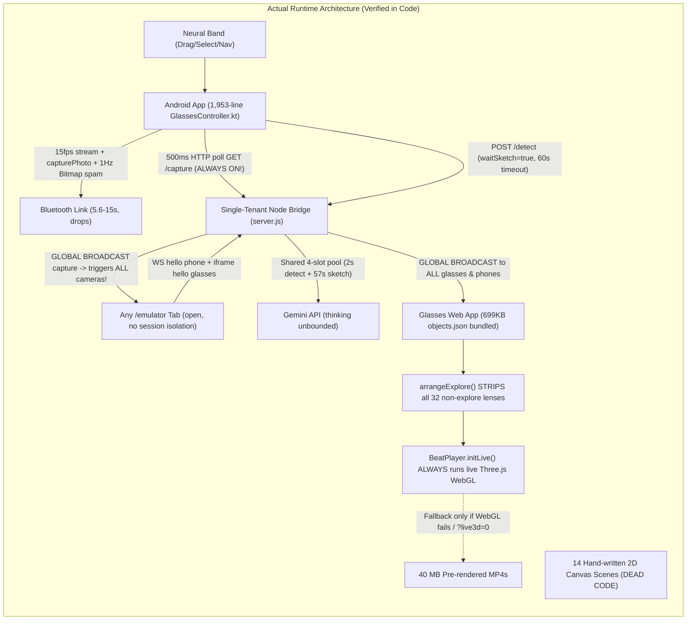
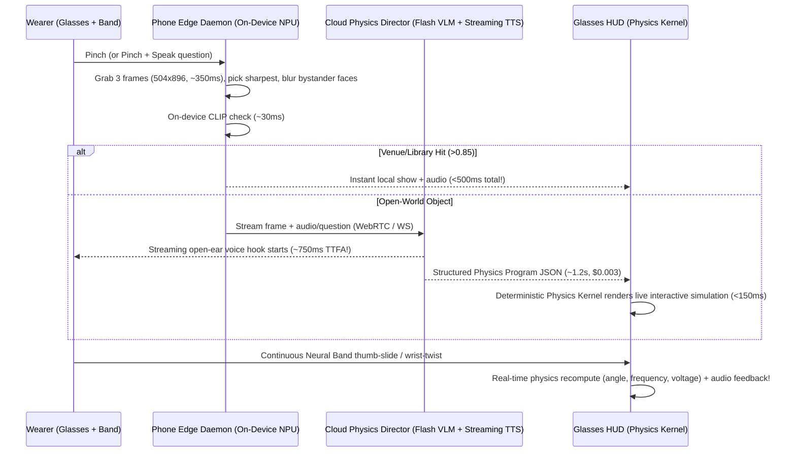

# WonderWhy: First-Principles Systems, Product & Code Audit

> **Repository:** `IceFrosst/WonderWhy` (extracted from `IceFrosst/Junction-2026`)
> **Target Hardware:** Meta Ray-Ban Display (600 × 600 monocular additive waveguide, 30 fps) + Meta Neural Band (surface EMG wristband) + Android companion (Meta Wearables DAT 1.0.1)
> **Audit Scope:** Full line-by-line review of the Node bridge, Glasses Web App (React + Three.js), Android DAT app (Kotlin), 3D renderer (`render3d`), shared specs/protocol/i18n, deployment stack, and documentation.

---

## 1. Executive Verdict

**WonderWhy has an unusually disciplined hackathon engineering foundation—and a deep architectural split-brain that breaks its own core promise.**

Credit where it is due: for a 35-hour hackathon build (185 commits across 32 of 35 hours), the team demonstrated rare engineering rigor in places most hackathon projects completely ignore:
- **Exceptional visual craft for additive optics:** Black-as-transparent rendering, semantic color roles with non-color cues, black text halos (`haloText`), and strict word caps in [DESIGN.md](Meta_Challenge/app/shared/DESIGN.md#L12-L54).
- **Clever first-principles aim fix:** Sending a 50% center crop (`focusBase64`) alongside the full frame to disambiguate what the wearer is looking at without eye tracking ([PROTOCOL.md](Meta_Challenge/app/shared/PROTOCOL.md#L21), [detect.js](Meta_Challenge/app/bridge/detect.js#L34-L38)).
- **Strong defensive hygiene & honesty:** Clock-isolated latency tracking, 455 automated checks (101 bridge tests, 172 Android JVM tests, 182 Playwright captures), and refreshingly candid documentation of what was vs. was not verified on real hardware.

**However, stripping away the hackathon story and auditing the actual code against first principles exposes severe structural failures:**

1. **The "3-second curiosity" thesis is violated by 3× to 25×.** Real-hardware end-to-end latency is **8.3–21+ seconds** for library objects (5.6–15 s Bluetooth photo transfer + 1.6–5.1 s cloud detect + 1.1–1.5 s render) and **65–75 seconds** for unknown objects—largely because of **self-inflicted bugs** (running `capturePhoto()` concurrently with a 15 fps video stream while spamming Bluetooth display cards every 1 s, plus letting Gemini think freely without `thinkingBudget`, plus asking an LLM to synthesize raw 3D CAD coordinates from scratch).
2. **A critical privacy/security flaw enables silent remote hijacking of real glasses and emulator webcams.** The bridge is completely **single-tenant with global WebSocket broadcast** ([server.js](Meta_Challenge/app/bridge/server.js#L285-L299)). Worse, the Android app polls `GET /capture` every 500 ms unconditionally ([GlassesController.kt](Meta_Challenge/app/android/app/src/main/java/com/junction2026/lens/GlassesController.kt#L512-L531)) and suppresses all glasses display UI when `webCaptureActive = true` ([GlassesController.kt](Meta_Challenge/app/android/app/src/main/java/com/junction2026/lens/GlassesController.kt#L807)). On the open judging bridge, **any visitor clicking "Take photo" silently triggers every other connected emulator's webcam—and any connected real glasses' camera—and broadcasts the recognized results to every connected client.**
3. **Massive code-vs-docs divergence & dead weight.**
   - **`arrangeExplore()` deletes all non-Explore lenses** ([explore.ts](Meta_Challenge/app/glasses/src/explore.ts#L258-L265)). Because all 12 objects in `objects.json` now have an `explore` chapter, **all 32 non-Explore chapters and all 14 hand-written 2D Canvas scenes are completely unreachable on the glasses Web App**, `POST /ask` cannot jump to a hinted lens on the glasses, and `gemini-4-carbon` wastes ~15–20 seconds and thousands of paid output tokens generating 3 extra sketch chapters (`flow`, `number`, `whatif`) that the glasses immediately throw away.
   - **Live WebGL runs first, not pre-rendered MP4s**, directly contradicting [ARCHITECTURE.md](docs/ARCHITECTURE.md#L43) and [MODEL3D.md](Meta_Challenge/app/shared/MODEL3D.md#L21)—pushing heavy CPU per-triangle JS silhouette extraction + `preserveDrawingBuffer: true` onto a low-power glasses WebView at 30 fps.
   - **Live unknown-object sketches are broken by mismatched timeouts:** the bridge takes ~57 s (`SKETCH_TIMEOUT_MS=90000`), while the glasses Web App hardcodes a **25 s failure timer** ([App.tsx](Meta_Challenge/app/glasses/src/App.tsx#L680-L689)) and Android blocks synchronously with `waitSketch=true` on a **60 s read timeout** ([BridgeClient.kt](Meta_Challenge/app/android/app/src/main/java/com/junction2026/lens/BridgeClient.kt#L123-L129)). Meanwhile, the wearer's voice `question` is **never passed to sketch generation** ([server.js](Meta_Challenge/app/bridge/server.js#L672-L675)), despite README claims.
4. **Wrong boundary between LLM and deterministic physics.** Asking a frontier reasoning LLM (`gemini-4-carbon`, ~57 s, ~\$0.10/call) to hand-code raw 3D vertex/primitive CAD JSON for every unknown object is a dead end on latency, cost, spatial fidelity, and physics accuracy. The LLM should be a **sub-second physics director** selecting and parameterizing **verified, deterministic physics simulation modules** while streaming an immediate voice explanation.

---

## 2. First-Principles Deconstruction of the Problem

Strip away every line of code in this repository. What is the irreducible problem WonderWhy is solving?

> **Core Problem:** A human holding or looking at a physical object experiences a fleeting ~3-second spark of causal curiosity (*"Why does this work?"*). Deliver an accurate, immediately graspable mechanistic explanation—hands-free, eyes-up, on a monocular smart-glasses display + EMG wristband—before that spark dies.

### Physical, Perceptual, and Hardware Constraints vs. Current Reality

| Constraint Domain | Irreducible Physics / Human Factors | What WonderWhy Built | First-Principles Verdict |
|---|---|---|---|
| **Curiosity Half-Life (Latency)** | Human attention window for casual curiosity is **1.5–3.0 s** to first meaningful feedback ("aha" hook), < 5 s to visual payoff. | Library objects: **8.3–21 s** on real hardware (5.6–15 s BT photo + 1.6–5.1 s detect + 1.1–1.5 s motion). Unknown objects: **~65–75 s** (57 s sketch). | **Critical miss.** Latency kills the exact product thesis stated in [README.md](README.md#L8). |
| **Monocular Additive Optics** | 600 × 600 right-eye waveguide, ~20° FoV, additive light (black = transparent), binocular rivalry if dense or bright, daylight washout, no 6-DoF world-locking in Web App/DAT. | Additive black ground, bright semantic wireframes, < 15% fill, black text halos, 16–20 px text, 2-line captions, auto-play with 20 s hold. | **Strongest part of the repo.** Visual language is genuinely glasses-native; however, full-stage opaque black scrims (`rgba(0,0,0,0.9)`) and tiny unlocalized 3D CAD turntables still compete with the real object. |
| **Modality Split (Audio vs. HUD)** | Open-ear audio has **zero visual occlusion**, ~0.6 s streaming TTFA, and carries causal narrative effortlessly. Additive HUD excels at **spatial structure, vectors, waveforms, and 1 key number**—not reading paragraphs. | Visual-first, silent by default; audio buried behind a "Listen" button using browser `speechSynthesis` ([ExploreView.tsx](Meta_Challenge/app/glasses/src/ExploreView.tsx#L649-L669)). | **Inverted modality priority.** Audio should deliver the 1-second hook; HUD should deliver synchronized kinetic visuals that reinforce what you hear. |
| **Egocentric Aiming (No Eye Tracking)** | Fixed head-mounted camera sits offset from the right eye with wide FoV; background objects easily dominate VLM attention. | Dual-image prompt (`imageBase64` + 50% center crop `focusBase64`). Validated 3/3 vs. 0/3 on cluttered scene. | **Smart pragmatic hack**, but lacks a center aim reticle during capture, motion-blur rejection, and on-device face/bystander filtering. |
| **Bluetooth Tether & Camera Pipeline** | Meta Display Web Apps have **no camera API**. Photos traverse Glasses → BT → Phone → Cloud → Glasses. BT Classic/BLE bandwidth is narrow and drops under concurrent load. | Starts a **15 fps MEDIUM video stream** AND calls full-res `capturePhoto()` concurrently while pushing 480×28 progress Bitmaps every 1 s over BT, then downscales HEIC to 896 px. | **Self-sabotaged transport.** Directly causes the 5.6–15 s latency and post-JPEG Bluetooth disconnects observed on the loaner ([Loaner_Test.md](Meta_Challenge/team-notes/Loaner_Test.md#L36-L37)). |
| **EMG Neural Band Bandwidth** | Surface EMG excels at **micro-pinch, discrete swipes, and continuous subtle thumb/wrist modulation**; high false-positive risk if triggers aren't gated/debounced. Real hardware emits `Drag DOWN→UP` + optional `Select`. | Mapped pinch (`Drag` heuristic + `Select`), D-pad, Back. Split across 5 incompatible input maps across Web App and Android native cards. | **Over-modalized.** Using the band like a 1995 TV remote wastes its best physical affordance: continuous analog manipulation of a live physics variable (frequency, angle, heat, explode). |
| **Glasses Compute & Thermal Budget** | Wearable SoC + mobile WebView has tight thermal/battery ceilings (`THERMAL_SEVERE` / `PEAK_POWER_SHUTDOWN`). | Runs Three.js WebGL live at 30 fps with `preserveDrawingBuffer: true`, `powerPreference: 'high-performance'`, 9 draw calls/part, and CPU JS per-triangle `smoothContour()` on every frame ([scene.js](Meta_Challenge/app/render3d/page/scene.js#L518-L656), [geometry.js](Meta_Challenge/app/render3d/page/geometry.js#L276-L333)). | **Thermal/battery time bomb.** Never benchmarked on real glasses; only measured in desktop headless Chrome. |
| **LLM vs. Deterministic Physics Boundary** | LLMs excel at semantic classification, pedagogy, and parameter estimation; they are slow, costly, and unreliable at 3D CAD geometry and quantitative physics. | Closed-set VLM for 12 hand-authored objects (fast, cheap), then falls back to `gemini-4-carbon` writing raw 3D primitive coordinates + physics numbers from scratch (57 s, ~\$0.10, unverified). | **Wrong abstraction for long-tail objects.** Needs a **Verified Parametric Physics Kernel** where the LLM acts as a ~1 s director, not a 60 s CAD draftsman. |
| **Privacy & Bystander Trust** | Pointing a head-worn camera in public captures non-consenting bystanders. Cloud uploads require ironclad isolation, minimal retention, and explicit local triggers. | Good first-run consent UI; zero disk storage of photos. **Broken by global WS broadcast + silent remote `/capture` trigger** and zero on-device face/person detection. | **Unacceptable privacy risk in current deployment.** Must be fixed before any public demo or venue pilot. |

---

## 3. Architecture Reality Check: Documented vs. Actual Code

One of the sharpest insights from reading every source file is how dramatically the final hackathon sprint caused the **actual runtime architecture** to drift from the **documented architecture**.

### Major Code-vs-Documentation Discrepancies

| Claim in Docs / README | Actual Code Reality | Exact Evidence |
|---|---|---|
| *"Swipe to change lens (Motion, Inside, Cutaway, Zoom, What if, Compare, Flow, The number)... Ask a follow-up and the glasses jump to the lens that answers it."* ([README.md](README.md#L24)) | **False on the Glasses Web App.** All 12 objects in `objects.json` have an `explore` chapter. `arrangeExplore()` strips every other chapter (`chapters: [chapter]`), making all 32 other lenses and all 14 2D scenes unreachable. `POST /ask` `lensHint` falls back to beat 1 of the Explore film. | [explore.ts](Meta_Challenge/app/glasses/src/explore.ts#L258-L265), [App.tsx](Meta_Challenge/app/glasses/src/App.tsx#L907-L926) |
| *"The glasses never run a 3D engine... The Web App plays the pre-rendered Explore film... 'Turn it' is built live in a lazy chunk (fetched about 3 s into the film)."* ([MODEL3D.md](Meta_Challenge/app/shared/MODEL3D.md#L21), [ARCHITECTURE.md](docs/ARCHITECTURE.md#L43-L77)) | **Inverted.** `BeatPlayer.initLive()` imports `@r3d/scene.js` (Three.js) immediately on mount and renders every beat live in WebGL at 30 fps. The 74 MP4 clips (40 MB) are only played as a fallback when WebGL fails or `?live3d=0` is set. | [ExploreView.tsx](Meta_Challenge/app/glasses/src/ExploreView.tsx#L161-L175), [ExploreView.tsx](Meta_Challenge/app/glasses/src/ExploreView.tsx#L771-L775) |
| *"For an object outside the library the bridge generates a live 3D explanation from the photo and your voice question."* ([README.md](README.md#L25), [README.md](README.md#L53), [ARCHITECTURE.md](docs/ARCHITECTURE.md#L42)) | **`question` is never passed to sketch generation.** `handleDetect` passes only `hint: result.answer || ''` to `finishSketch`, and `buildSketchPrompt` does not even accept a `question` parameter. | [server.js](Meta_Challenge/app/bridge/server.js#L672-L675), [sketch.js](Meta_Challenge/app/bridge/sketch.js#L290-L313) |
| *"Always arrives within `SKETCH_TIMEOUT_MS` (90 000 on the live bridge)"* ([PROTOCOL.md](Meta_Challenge/app/shared/PROTOCOL.md#L119)) | **Glasses UI times out at 25 s** (displaying `"No sketch for this one."` 32 s before `gemini-4-carbon` finishes at 57 s), and **Android times out at 60 s** (`readTimeoutMs = 60_000` with `waitSketch = true`). | [App.tsx](Meta_Challenge/app/glasses/src/App.tsx#L680-L689), [BridgeClient.kt](Meta_Challenge/app/android/app/src/main/java/com/junction2026/lens/BridgeClient.kt#L123-L129) |
| *"In-app dictation in the Web App's Ask screen; a 'Hey Meta' tool registered through WebMCP"* ([UX_ACCESSIBILITY_TRUST.md](docs/UX_ACCESSIBILITY_TRUST.md#L15)) | **Hardcoded 2-word regex stub.** Both `AskScreen` and the WebMCP tool call `spokenObject()` which matches only `phone` and `kettle`—they never call `POST /ask` and cannot open the other 10 library objects. | [App.tsx](Meta_Challenge/app/glasses/src/App.tsx#L86-L92), [App.tsx](Meta_Challenge/app/glasses/src/App.tsx#L644-L660), [App.tsx](Meta_Challenge/app/glasses/src/App.tsx#L1196-L1202) |
| *"Camera starts on pinch, button or 'Again', takes one photo, releases the camera"* ([UX_ACCESSIBILITY_TRUST.md](docs/UX_ACCESSIBILITY_TRUST.md#L56)) | **True locally, false remotely.** Any WebSocket client on the bridge can silently trigger the Android app's camera via `type: "capture"` (with all glasses display cards suppressed!) or trigger every other user's `/emulator` webcam. | [server.js](Meta_Challenge/app/bridge/server.js#L881), [GlassesController.kt](Meta_Challenge/app/android/app/src/main/java/com/junction2026/lens/GlassesController.kt#L512-L531), [emulator.html](Meta_Challenge/app/bridge/public/emulator.html#L274) |

---

## 4. Deep-Dive Audit: Concrete Bugs, Race Conditions, Security & Performance Traps

### 4.1 Critical Security & Privacy Flaws

#### 1. Single-Tenant Global Broadcast & Silent Remote Camera Hijack (Severity: Critical)
- **Where:** [server.js](Meta_Challenge/app/bridge/server.js#L285-L299), [server.js](Meta_Challenge/app/bridge/server.js#L444-L445), [server.js](Meta_Challenge/app/bridge/server.js#L666), [server.js](Meta_Challenge/app/bridge/server.js#L875-L882), [GlassesController.kt](Meta_Challenge/app/android/app/src/main/java/com/junction2026/lens/GlassesController.kt#L512-L531), [GlassesController.kt](Meta_Challenge/app/android/app/src/main/java/com/junction2026/lens/GlassesController.kt#L807), [emulator.html](Meta_Challenge/app/bridge/public/emulator.html#L274).
- **Exact failure mechanism:**
  1. The bridge has **no concept of a session, room, or paired device**. All glasses clients live in one `Set` (`glasses`), all phone/emulator clients live in one `Set` (`phones`), and there is one global `pendingCapture` and one global `lastShow`.
  2. In [GlassesController.kt](Meta_Challenge/app/android/app/src/main/java/com/junction2026/lens/GlassesController.kt#L512-L531), **every** connected Android session—even when `cameraOnly = false`—runs an infinite `while` loop polling `GET /capture?after=...` every 500 ms.
  3. On the live bridge (`LENS_ALLOW_OPEN=1`), any unauthenticated client can open `/ws`, send `{type:"hello", client:"glasses"}`, and send `{type:"capture"}`.
  4. **Effect A (Real glasses silent capture):** Within 500 ms, the Android app receives `{capture: true}`, calls `tryTrigger(fromWeb = true)` which sets `webCaptureActive = true`, **suppressing all display cards including "Taking the photo"** ([GlassesController.kt](Meta_Challenge/app/android/app/src/main/java/com/junction2026/lens/GlassesController.kt#L807)), snaps a photo from the wearer's glasses, sends it to Gemini, and broadcasts the resulting object/description (`show`) to every connected WebSocket client!
  5. **Effect B (Cross-judge webcam hijack on `/emulator`):** If Judge A and Judge B both open `/emulator` concurrently and Judge A triggers "Take photo", `server.js:881` broadcasts `{type:"capture"}` to **all** `phones` sockets. Judge B's `emulator.html:274` automatically runs `photo()`, snapping Judge B's webcam without consent and broadcasting Judge B's result onto Judge A's screen (and vice versa).
  6. **Effect C (Cross-session interference):** Even without `capture`, Judge A's `POST /detect` overwrites `lastShow` and pushes `detecting` + `show` + `sketch` to Judge B's glasses iframe via `both(...)`, and Judge A's `clear` increments global `clearGeneration`, cancelling Judge B's in-flight request!

#### 2. Cleartext Traffic & Plaintext Credential Storage on Android (Severity: High)
- **Where:** [AndroidManifest.xml](Meta_Challenge/app/android/app/src/main/AndroidManifest.xml#L20), [Prefs.kt](Meta_Challenge/app/android/app/src/main/java/com/junction2026/lens/Prefs.kt#L20-L21).
- **Detail:** `android:usesCleartextTraffic="true"` allows plaintext HTTP transmission of user camera photos and `X-Lens-Token` on any network if an HTTP URL is entered (instead of restricting cleartext strictly to `localhost` / `10.0.2.2` via `network_security_config.xml`). `bridgeToken` is stored in plaintext `SharedPreferences`.

#### 3. Inconsistent Consent Disclosures & Zero Bystander Enforcement (Severity: Medium–High)
- **Where:** [App.tsx](Meta_Challenge/app/glasses/src/App.tsx#L455-L457), [emulator.html](Meta_Challenge/app/bridge/public/emulator.html#L77), [UX_ACCESSIBILITY_TRUST.md](docs/UX_ACCESSIBILITY_TRUST.md#L57), [UX_ACCESSIBILITY_TRUST.md](docs/UX_ACCESSIBILITY_TRUST.md#L81).
- **Detail:** The Android consent card does not mention Google Gemini or bystanders. There is no on-device face/person detection to block or blur non-consenting bystanders before uploading JPEGs to Google.

---

### 4.2 Hardware, Bluetooth & Android DAT Bugs

#### 4. Self-Inflicted Bluetooth Congestion & 5.6–15 s Capture Latency (Severity: Critical)
- **Where:** [GlassesController.kt](Meta_Challenge/app/android/app/src/main/java/com/junction2026/lens/GlassesController.kt#L990), [GlassesController.kt](Meta_Challenge/app/android/app/src/main/java/com/junction2026/lens/GlassesController.kt#L1063-L1075), [GlassesController.kt](Meta_Challenge/app/android/app/src/main/java/com/junction2026/lens/GlassesController.kt#L1860-L1927), [Cards.kt](Meta_Challenge/app/android/app/src/main/java/com/junction2026/lens/Cards.kt#L76-L95).
- **Root cause (three compounding mistakes):**
  1. **Simultaneous video stream + high-res photo capture:** `takePhotoJpeg()` starts `StreamConfiguration(videoQuality = VideoQuality.MEDIUM, frameRate = 15)` and calls `camera.stream.capturePhoto()` while the 15 fps stream is running—directly contradicting the team's own SDK note in [Platform_Notes.md](Meta_Challenge/team-notes/Platform_Notes.md#L37): *"Photo: High-quality capture on demand (`camera.photo`). It competes with the stream, so stop the stream first."*
  2. **1 Hz Bitmap card spam over the same Bluetooth link:** `withProgress("Taking the photo", ...)` creates a fresh `480×28` ARGB_8888 `Bitmap` and calls `d.sendContent(...)` **every 1,000 ms** while Bluetooth is saturated transferring the full-res HEIC photo! This directly explains why *"Other attempts lost Bluetooth immediately after JPEG delivery"* ([Loaner_Test.md](Meta_Challenge/team-notes/Loaner_Test.md#L36-L37)).
  3. **Transferring 12 MP HEIC only to downsample to 896 px:** `encode()` ([GlassesController.kt](Meta_Challenge/app/android/app/src/main/java/com/junction2026/lens/GlassesController.kt#L1918)) immediately shrinks the photo to `896 px` max side. Meanwhile, DAT's `VideoQuality.MEDIUM` stream is **already `504×896`** ([Platform_Notes.md](Meta_Challenge/team-notes/Platform_Notes.md#L36))! Grabbing 1 sharp frame from a `2–7 fps MEDIUM` video stream avoids `capturePhoto()` entirely and cuts transfer payload by > 10× (from ~5.6–15 s down to ~0.5–1.5 s).

#### 5. Heavy Image Decoding & Encoding on `Dispatchers.Main` + Bitmap Leaks (Severity: High)
- **Where:** [GlassesController.kt](Meta_Challenge/app/android/app/src/main/java/com/junction2026/lens/GlassesController.kt#L990), [GlassesController.kt](Meta_Challenge/app/android/app/src/main/java/com/junction2026/lens/GlassesController.kt#L1890), [GlassesController.kt](Meta_Challenge/app/android/app/src/main/java/com/junction2026/lens/GlassesController.kt#L1904-L1927), [MainActivity.kt](Meta_Challenge/app/android/app/src/main/java/com/junction2026/lens/MainActivity.kt#L137).
- **Detail:** `GlassesController.scope` is `lifecycleScope` (`Dispatchers.Main.immediate`). `encode(photo)` runs `BitmapFactory.decodeByteArray` (12 MP HEIC), matrix rotation, `createScaledBitmap`, center cropping, and two JPEG compressions **on the Android main UI thread**, freezing frame rendering and coroutine dispatch for hundreds of milliseconds, without calling `.recycle()` on intermediate Bitmaps (`bmp`, `upright`, `out`, `focus`).

#### 6. Unconditional 500 ms HTTP Polling Loop Draining Phone Battery (Severity: Medium)
- **Where:** [GlassesController.kt](Meta_Challenge/app/android/app/src/main/java/com/junction2026/lens/GlassesController.kt#L512-L531).
- **Detail:** Opens a fresh `HttpURLConnection` to `GET /capture` every 500 ms (120 requests/min, 7,200/hour) for the entire lifetime of every session—even when `cameraOnly == false`—preventing cellular/Wi-Fi radio sleep and generating massive server noise.

#### 7. Android Sketch Timeout & Discarded Sketches on `askWithPhoto` (Severity: High)
- **Where:** [BridgeClient.kt](Meta_Challenge/app/android/app/src/main/java/com/junction2026/lens/BridgeClient.kt#L123-L129), [GlassesController.kt](Meta_Challenge/app/android/app/src/main/java/com/junction2026/lens/GlassesController.kt#L1019-L1027).
- **Detail:**
  - Android sends `waitSketch = true` with `readTimeoutMs = 60_000`. With ~2 s detect + ~57 s `gemini-4-carbon` sketch (bridge `SKETCH_TIMEOUT_MS=90000`), Android hangs silently on a progress bar for a full minute and throws `SocketTimeoutException` on any run > 58 s, discarding even the 2-second text answer.
  - If `askWithPhoto == true` and the object is `unknown`, line 1020 matches `q != null && !det.answer.isNullOrBlank()` and routes to `showAnswer()`, **completely discarding `det.sketch`** even after forcing the user to wait 57 seconds for it!

#### 8. Hardcoded `phone` Special-Case Hack Breaking Navigation Consistency (Severity: Medium)
- **Where:** [GlassesController.kt](Meta_Challenge/app/android/app/src/main/java/com/junction2026/lens/GlassesController.kt#L1790-L1797), [Detection.kt](Meta_Challenge/app/android/app/src/main/java/com/junction2026/lens/Detection.kt#L377-L385).
- **Detail:** For `objectId == "phone"` only, Left/Right D-pad swipes are hijacked to toggle `doneSelected` instead of switching lenses, and `DetectionParser.tracks()` hardcodes a phone-only chapter filter (`phone.whatif`, `phone.inside`)—a classic demo-day hack left behind in core logic.

---

### 4.3 Bridge, VLM Prompting, Latency & Cost Traps

#### 9. Unbounded Gemini Thinking Tokens Inflating Latency & Cost (Severity: High)
- **Where:** [detect.js](Meta_Challenge/app/bridge/detect.js#L100-L109).
- **Detail:**
  - `callGemini` defaults `GEMINI_MODEL` to `'gemini-4-carbon'` (the expensive, slow reasoning model) instead of a flash model.
  - Worse, lines 105–107 note that *"Gemini 3+/4 models think before answering and the thinking counts toward `maxOutputTokens`"*—so instead of passing `thinkingConfig: { thinkingBudget: 0 }` (or a tight cap like `256`) for closed-set 12-class JSON classification and 14-word `/ask` routing, the code sets `maxOutputTokens: Math.max(maxTokens || 0, 4096)`.
  - **Quantified impact:** Uncapped thinking adds **~1.0–1.5 s** of latency to every `gemini-3.6-flash` recognition call (turning a ~0.5 s call into 1.6–2.2 s) and inflates output tokens by 5×–10× (which cost **5× more per token** than input tokens: \$3.75–\$7.50/M vs. \$0.75–\$1.50/M).

#### 10. Global Concurrency Starvation (4-Slot Pool Shared by 2 s Detect and 90 s Sketch) (Severity: High)
- **Where:** [server.js](Meta_Challenge/app/bridge/server.js#L304-L309), [server.js](Meta_Challenge/app/bridge/server.js#L338), [server.js](Meta_Challenge/app/bridge/server.js#L589), [server.js](Meta_Challenge/app/bridge/server.js#L596).
- **Detail:** `MAX_INFLIGHT` (default 4) is shared across `/detect` (~2 s), `/ask` (~1.5 s), and background `finishSketch` (~57–90 s). Just **4 unknown-object requests** saturate all 4 slots for a full minute, returning `429 busy` to every library recognition and follow-up question on the server!

#### 11. Fragile All-or-Nothing Sketch Validation Discarding \$0.10 / 57 s Generations (Severity: High)
- **Where:** [sketch.js](Meta_Challenge/app/bridge/sketch.js#L264-L287), [model3d.js](Meta_Challenge/app/bridge/model3d.js#L301-L333).
- **Detail:**
  1. In `validateSketch()` ([sketch.js](Meta_Challenge/app/bridge/sketch.js#L274-L276)), if an `explore` chapter fails validation, it is skipped—**but if `flow`, `number`, or `whatif` fails any single constraint** (e.g., `knob.value === 0`, non-ascending x-point, 4 captions on `number`), `return null` **discards the entire 57-second, \$0.10 sketch—including the valid 3D model!**
  2. Even more absurdly, because `arrangeExplore()` on the glasses discards `flow`/`number`/`whatif` whenever `explore` exists, the bridge asks `gemini-4-carbon` to generate 3 unused chapters (~30–40% of output tokens and latency) whose minor validation flaws can kill the one chapter the glasses actually render!
  3. In `validateModel3d()` ([model3d.js](Meta_Challenge/app/bridge/model3d.js#L308-L329)), skipping a single invalid part (`if (!clean) continue`) breaks every beat referencing that part ID in `camera.target` or `fx.on`, causing `beat()` to return `null`, which breaks `beats.length !== expected` (line 328), discarding the entire 3D scene instead of gracefully stripping the broken `target`/`fx`!
  4. **Zero sketch caching:** Pointing twice at a coffee mug or stapler pays 57 s and \$0.10 every single time.

#### 12. Blocking Synchronous File I/O, Swallowed Crashes & 2 MB Regex (Severity: Medium)
- **Where:** [server.js](Meta_Challenge/app/bridge/server.js#L45-L87), [server.js](Meta_Challenge/app/bridge/server.js#L107-L111), [server.js](Meta_Challenge/app/bridge/server.js#L907-L908).
- **Detail:**
  - `serveFile()` calls `readFileSync(file)` on entire MP4 files even for 1 KB HTTP `Range` requests, blocking the Node event loop and allocating full-file buffers on every seek.
  - `validJpegBase64()` runs a catastrophic-backtracking-adjacent regex across up to 2 MB of base64 text AND allocates a full decoded `Buffer` just to inspect bytes `[0]` and `[1]` (`0xff 0xd8`), twice per request (`imageBase64` + `focusBase64`, then again on line 661 for `shouldSketch`!).
  - Lines 907–908 swallow `uncaughtException` and `unhandledRejection` without logging the error object or stack trace and without exiting—leaving the server running in an undefined state after fatal errors.

---

### 4.4 Glasses Web App & 3D Renderer Bugs

#### 13. Premature 25 s Client Sketch Timeout + Ghost Pop-In Bug (Severity: High)
- **Where:** [App.tsx](Meta_Challenge/app/glasses/src/App.tsx#L680-L689), [App.tsx](Meta_Challenge/app/glasses/src/App.tsx#L800-L818).
- **Detail:** `armSketchTimer` hardcodes `25000` ms even though live sketches take ~57 s (server timeout 90 s). At 25 s, the UI flips to `"No sketch for this one."`. Because `applySketch` does not check `sketchState === 'pending'`, if the wearer happens not to press Home, the sketch pops in 32 s *after* the app declared failure.

#### 14. 699 KB Static `objects.json` Bundled Into First Load + Unused Post-Processing Chunk Bloat (Severity: High)
- **Where:** [content.ts](Meta_Challenge/app/glasses/src/content.ts#L1), [scene.js](Meta_Challenge/app/render3d/page/scene.js#L7-L14), [scene.js](Meta_Challenge/app/render3d/page/scene.js#L533).
- **Detail:**
  - `objects.json` is **699,211 bytes** raw—containing all 12 objects' full 3D geometry specs AND all 32 unreachable 2D chapter specs—statically imported into the first-load JS bundle (pushing cold load to **261 KB gzip**, dangerously close to Meta's 300 KB hard limit, and preventing adding new objects without rebuilding/redeploying the glasses Web App!).
  - `@r3d/scene.js` statically imports `EffectComposer`, `RenderPass`, `UnrealBloomPass`, `OutputPass`, `ShaderPass`, `real.js`, and `overlay.js` into the glasses' lazy Three.js chunk (`166 KB gzip`), even though `new Explore(canvas, {live: true})` returns early at line 533 and **never uses any composer or bloom pass**!

#### 15. Expensive Per-Frame CPU Geometry Loops & Mobile GPU Anti-Patterns (Severity: High)
- **Where:** [scene.js](Meta_Challenge/app/render3d/page/scene.js#L518-L525), [scene.js](Meta_Challenge/app/render3d/page/scene.js#L634-L656), [scene.js](Meta_Challenge/app/render3d/page/scene.js#L1054-L1138), [geometry.js](Meta_Challenge/app/render3d/page/geometry.js#L276-L333).
- **Detail:**
  - `preserveDrawingBuffer: true` forces full framebuffer preservation/blits on tiled mobile GPUs (Snapdragon AR/Adreno), severely hurting fill-rate and battery.
  - `powerPreference: 'high-performance'` requests peak GPU clocks on a thermally constrained glasses form factor.
  - For a 35-part model (`sauna`, `printer3d`), line mode builds **9 draw calls per part** (1 stencil prepass + 4 fill meshes + 4 `LineSegments2` passes = **315 draw calls/frame**), runs CPU JS `smoothContour()` across thousands of triangles per frame, copies vertices into JS arrays (`out.push(...cross)`), copies into `Float32Array`, and re-uploads every part's GPU vertex/color buffer 30 times per second!
  - In `scene.js:733-743`, `clear()` disposes `child.geometry` and `child.material` for direct children but does not dispose `LineBatch` geometries/materials properly when switching specs or `this.lights`/composers.

#### 16. Broken 2D Lens Controls, Hidden Home Objects, Stubbed Ask/Voice & Infinite Error-Boundary Loop (Severity: Medium–High)
- **Where:** [Explainer.tsx](Meta_Challenge/app/glasses/src/Explainer.tsx#L348-L357), [App.tsx](Meta_Challenge/app/glasses/src/App.tsx#L194-L196), [App.tsx](Meta_Challenge/app/glasses/src/App.tsx#L86-L92), [main.tsx](Meta_Challenge/app/glasses/src/main.tsx#L22-L24).
- **Detail:**
  - Even if a 2D lens is reached (e.g., an unknown sketch whose `explore` chapter failed validation), `Explainer.tsx:351-357` captures `ArrowLeft`/`ArrowRight` to move button focus and never calls `emitNav('left'|'right')`—making multi-lens swiping impossible from the glasses/Neural Band!
  - `HomeScreen` hardcodes a 6-object whitelist (`['earbuds', 'phone', 'printer3d', 'sauna', 'spinbike', 'glasses']`), hiding `kettle`, `guitar`, `ball`, `bicycle`, `spoon`, and `pendulum` unless `?all=1` is appended.
  - `AppBoundary.componentDidCatch` schedules `setTimeout(..., 0)` to remount `<App />` infinitely with no retry cap—a persistent boot error creates an infinite 60 Hz flash loop (violating [DESIGN.md](Meta_Challenge/app/shared/DESIGN.md#L86): *"Never: Flashing faster than 3 per second"*).
  - Running `node Meta_Challenge/app/shared/i18n/check.mjs` confirms **75 failures (15 per language across `de`, `es`, `fi`, `fr`, `sv`)**, and all Web App UI buttons (`Pause`, `Turn it`, `Listen`, `Home`, `New photo`, `Watch again`) and device cards are hardcoded in English ([ExploreView.tsx](Meta_Challenge/app/glasses/src/ExploreView.tsx#L1118-L1128), [App.tsx](Meta_Challenge/app/glasses/src/App.tsx#L171-L176)).

---

## 5. Economics & Latency Math (Actual vs. First-Principles Ideal)

Let's quantify the current bottlenecks and unit economics directly from the code and pricing data in [USE_CASE.md](docs/USE_CASE.md#L91-L129):

### End-to-End Latency Breakdown (Real Hardware Path)

| Stage | Current Library Object | Current Unknown Object | Root Cause of Overhead | Target (Post-Tier 2/3) |
|---|---:|---:|---|---:|
| **1. Capture → Phone (BT)** | 5,594 – 15,000 ms | 5,594 – 15,000 ms | 15 fps stream + full-res HEIC `capturePhoto()` + 1 Hz Bitmap spam | **350 – 700 ms** (1 frame from 504×896 stream) |
| **2. Phone Encode & Privacy Gate** | ~150 – 300 ms (on UI thread) | ~150 – 300 ms | Main-thread HEIC decode + double JPEG | **40 – 80 ms** (background YUV→JPEG + on-device blur/face gate) |
| **3. Cloud Recognition / Audio Hook** | 1,600 – 2,200 ms (`3.6-flash`) | 1,600 – 2,200 ms | Uncapped thinking tokens (`maxOutputTokens: 4096`) + 2 JPEGs | **30 – 50 ms** (on-device CLIP for library) / **500 – 800 ms** (cloud flash, `thinkingBudget: 0`, streaming TTS) |
| **4. Visual / 3D Generation** | 0 ms (pre-authored) | **57,000 ms** (`4-carbon`) | Raw 3D CAD JSON + 3 discarded 2D chapters, no cache | **0 ms** (library/cache) / **800 – 1,800 ms** (LLM-parameterized Physics Kernel) |
| **5. Glasses First Motion** | 1,133 – 1,546 ms | 1,133 – 1,546 ms | Cold lazy chunk (166 KB Three.js) + CPU edge build | **< 200 ms** (lean GPU shader / lightweight 2D+3D runtime) |
| **TOTAL Pinch → "Aha"** | **8.5 – 19.0 s** | **65.5 – 76.0 s** | **3× – 25× over 3-second curiosity half-life** | **0.8 – 1.2 s (voice) / 1.2 – 2.5 s (visual)** |

### Unit Economics (List Prices from Jan 2027)

| Path | Current Model & Token Shape | Cost / Query | Cost / 1,000 Queries (20% Unknown) | Redesigned (On-Device Library + Flash Director + Cache) |
|---|---|---:|---:|---:|
| **Library Object** | `gemini-3.6-flash` (2 images, unbounded thinking) | \$0.004 – \$0.012 | \$3.00 – \$9.60 | **\$0.000** (on-device MobileCLIP) or **\$0.001** (flash, `thinkingBudget: 0`) |
| **Unknown Object (Cold)** | `gemini-4-carbon` (2k in, 8–12k out incl. 3 unused chapters) | \$0.168 – \$0.248 | \$33.60 – \$49.60 | **\$0.002 – \$0.005** (flash director selecting verified Physics Module) |
| **Unknown Object (Repeat)** | **No cache** — regenerates every time! | \$0.168 – \$0.248 | — | **\$0.000** (semantic canonical cache hit) |
| **Total / 1,000 Sessions** | **\$37.35 – \$61.60** | — | — | **\$0.50 – \$2.50 (25× – 75× cheaper)** |

---

## 6. Three-Tier Upgrade Roadmap

### Tier 1: Surgical Fixes & Immediate Hardening (1–3 Days)

*Zero paradigm changes—fix the acute security holes, broken timeouts, BT congestion, and dead code paths in the existing stack.*

1. **Add Session/Room Isolation & Kill Remote Camera Hijack (`server.js`, `emulator.html`, `GlassesController.kt`, `bridge.ts`)**
   - Require a per-session `roomId` (e.g., 6-char pairing code or random UUID generated by `/emulator` or the Android app and passed to the glasses URL `#room=...`) on `/ws` `hello`, `/detect`, `/ask`, `/capture`, and `/last`.
   - Scope `glasses`, `phones`, `lastShow`, `pendingCapture`, `requestSequence`, and `clearGeneration` **per `roomId`** (stored in a `Map<string, Room>` with idle TTL cleanup).
   - **Never poll `/capture` in Android unless `cameraOnly == true`**, and when a remote capture fires, either require a local Band confirmation or keep an explicit visual indicator on the glasses display.
   - Replace `android:usesCleartextTraffic="true"` with a `network_security_config.xml` allowing cleartext only for `localhost` / `10.0.2.2`; store `bridgeToken` in `EncryptedSharedPreferences`.

2. **Fix Bluetooth Photo Latency & Disconnects (`GlassesController.kt`)**
   - **Replace `capturePhoto()` with a single video-frame grab** from `StreamConfiguration(videoQuality = VideoQuality.MEDIUM, frameRate = 7)` (already 504×896—no HEIC transfer or downscaling needed!). Capture 3 frames over ~400 ms, pick the sharpest via Laplacian variance (prevents motion blur!), and immediately call `camera.stop(); sess.removeCamera()`.
   - **Stop spamming 1 Hz Bitmap progress cards during BT capture:** send ONE lightweight text-only `"Looking..."` card on pinch; only start a text-only timer *after* Bluetooth transfer completes and HTTP upload begins.
   - Move `encode()` to `withContext(Dispatchers.Default)` and explicitly `.recycle()` intermediate Bitmaps.

3. **Unbreak Live Sketches & Cut Recognition Latency in Half (`detect.js`, `server.js`, `sketch.js`, `App.tsx`, `BridgeClient.kt`)**
   - In [detect.js](Meta_Challenge/app/bridge/detect.js#L101-L107): change default `GEMINI_MODEL` to `gemini-3.6-flash` and pass `thinkingConfig: { thinkingBudget: 0 }` for `/detect` and `/ask` (use `responseSchema` for guaranteed valid JSON).
   - Separate concurrency pools in [server.js](Meta_Challenge/app/bridge/server.js#L304-L309): e.g., `MAX_DETECT_INFLIGHT=6`, `MAX_SKETCH_INFLIGHT=2`, so slow sketches never starve `/detect` or `/ask`.
   - Pass `question` from `handleDetect` into `finishSketch` → `buildSketchPrompt`.
   - Send `sketchTimeoutMs` on `show` when `sketchPending: true`, and replace the hardcoded `25000` in [App.tsx](Meta_Challenge/app/glasses/src/App.tsx#L688) with `m.sketchTimeoutMs + 5000`.
   - On Android ([BridgeClient.kt](Meta_Challenge/app/android/app/src/main/java/com/junction2026/lens/BridgeClient.kt#L123)): stop blocking `/detect` with `waitSketch = true`! Return the 2-second recognition answer immediately and poll/subscribe for the sketch asynchronously (or show the 2 s text card with `"Drawing 3D sketch..."` and update when ready).
   - Fix `validateSketch` ([sketch.js](Meta_Challenge/app/bridge/sketch.js#L274-L277)): drop individual invalid chapters instead of discarding the entire sketch; in `validateModel3d` ([model3d.js](Meta_Challenge/app/bridge/model3d.js#L252-L296)), strip invalid `target`/`fx` references instead of invalidating the whole beat.
   - **Stop generating unused chapters** (or fix `arrangeExplore()` so all lenses are actually reachable!). If keeping `explore`-only on glasses, cut `flow`, `number`, and `whatif` from `buildSketchPrompt`—immediately saving ~35% of sketch tokens and ~15–20 s of generation latency!
   - Add a simple LRU + disk-backed sketch cache keyed by normalized object name + language (`cache/sketches/<slug>.<lang>.json`).

4. **Fix Web App Bugs, Bridge I/O & Dead Ends**
   - Wire `AskScreen` and the WebMCP voice tool ([App.tsx](Meta_Challenge/app/glasses/src/App.tsx#L644-L660)) to `POST /ask` (or match all 12 objects + `/ask`), removing the 2-object `spokenObject()` regex stub.
   - Remove the `objectId == "phone"` navigation hack in [GlassesController.kt](Meta_Challenge/app/android/app/src/main/java/com/junction2026/lens/GlassesController.kt#L1790-L1797).
   - Cap retries in `AppBoundary` ([main.tsx](Meta_Challenge/app/glasses/src/main.tsx#L22-L24)) to 1 retry, then show a static recovery card.
   - Stream MP4 files with `fs.createReadStream(file, { start, end })` in [server.js](Meta_Challenge/app/bridge/server.js#L45-L87); check JPEG magic bytes from the first 4 base64 chars (`value.startsWith('/9j/')`) instead of regexing + decoding 2 MB; log full error stacks and exit cleanly on `uncaughtException`.
   - Regenerate and validate the 5 i18n JSON files so `i18n/check.mjs` exits 0, and add `prefers-reduced-motion` support (`autoPlay = false`, static beats by default).

---

### Tier 2: Structural & Architectural Upgrades (2–4 Weeks)

*Make the current architecture fast, thermally safe on real glasses, maintainable as one codebase, and genuinely extensible.*

1. **Eliminate the 699 KB First-Load Bundle & Split Offline vs. Live Renderers**
   - Remove `import objectsJson from '../../shared/objects.json'` from [content.ts](Meta_Challenge/app/glasses/src/content.ts#L1). Ship only a ~2 KB manifest (`id`, `label`, `short`, `tagline`) in the initial bundle and fetch individual object specs on demand from `GET /objects/:id?lang=` (cached in Cache API / IndexedDB for offline use). First-load gzip drops from **261 KB → ~75 KB**—leaving massive headroom under Meta's 300 KB gate and letting venues add objects with zero frontend rebuilds.
   - Split `@r3d/scene.js` into `scene-offline.js` (with `EffectComposer`, `UnrealBloomPass`, `real.js`, `overlay.js` for headless video rendering) and a lean `scene-live.js` (~40 KB gzip) for the glasses.

2. **Replace CPU Per-Frame Silhouette Loops With GPU-Native Additive Wireframe Shaders**
   - Remove `preserveDrawingBuffer: true` and `powerPreference: 'high-performance'` from [scene.js](Meta_Challenge/app/render3d/page/scene.js#L518-L525).
   - Replace per-frame CPU JS `smoothContour()` + `LineBatch` buffer re-uploads ([geometry.js](Meta_Challenge/app/render3d/page/geometry.js#L276-L333)) with:
     - **Static pre-computed crease `LineSegments`** (uploaded to GPU once on `load()`, transformed purely by `modelViewMatrix` on GPU—zero per-frame JS vertex loops!).
     - **GPU Fresnel / Rim-Contour Fragment Shader** (`smoothstep(0.18, 0.0, abs(dot(N, V)))`) on a single mesh pass per part for smooth curved silhouettes!
   - **Result:** Cuts draw calls from **9 per part → 2 per part** (315 → 70 on 35-part models), cuts CPU JS frame time by **> 10×**, and cuts glasses GPU power/heat dramatically.

3. **Decide Once and For All: Multi-Lens vs. Explore-Only (Delete the Dead Architecture)**
   - Right now the codebase pays full complexity tax for **three** parallel rendering systems (14 2D Canvas scenes + 40 MB MP4s + live WebGL 3D) while only using one.
   - **Recommended unified model:** Keep **Live 3D Explore** (with lean GPU shader) + **3 data-driven interactive 2D lenses** (`flow`, `number`, `curve`—which work for *both* library and generated objects!), and **delete the 10 bespoke single-object 2D scenes** (`ball.ts`, `guitar.ts`, `bicycle.ts`, `kettle.ts`, `cutaway.ts`, `pendulum.ts`, `bounce.ts`, `earbuds.ts`, `exploded.ts`, `zoom.ts`) AND stop shipping 40 MB of MP4s in git (keep lightweight 600×600 WebP stills for fallback/Android offline cards).
   - Fix `arrangeExplore()` so `explore` is Lens 1, and swiping Left/Right in a dedicated lens-switcher (or jumping via `POST /ask` `lensHint`) smoothly transitions to `flow`, `number`, or `whatif` (interactive curve).

4. **On-Device Edge Triage on Android (Privacy + Blur + Offline Fast-Path)**
   - Add a lightweight on-device pipeline on the Android phone (~30–60 ms total, zero cloud cost):
     - **Blur/Exposure Rejector:** Laplacian variance check across a 3-frame burst from the DAT video stream -> picks sharpest frame automatically before cloud upload.
     - **Bystander Privacy Gate:** On-device MediaPipe / ML Kit Face Detection (~15 ms). If a face occupies > 15% of the center crop, refuse capture locally (*"Point at an object, not a person"*)—actually implementing the unbuilt promise in [UX_ACCESSIBILITY_TRUST.md](docs/UX_ACCESSIBILITY_TRUST.md#L81). If background faces appear outside the center crop, Gaussian-blur them before base64 encoding!
     - **On-Device Library Fast-Path:** Embed the 12–50 venue objects using MobileCLIP / EfficientNet embeddings on Android. High-margin cosine hits (> 0.85) resolve in **< 40 ms completely offline at \$0 cost**; ambiguous frames fall through to cloud Gemini.

5. **Real Bridge Observability, CI & Token Accounting**
   - Record Gemini `usageMetadata` (`promptTokenCount`, `candidatesTokenCount`, `thoughtsTokenCount`) in `latency.jsonl` and `/latency` so cost is measured, never guessed.
   - Add automated GitHub Actions CI running: bridge `npm test`, glasses `tsc --noEmit && vite build` + bundle size assertion, `i18n/check.mjs`, `check-md-links.mjs --anchors`, and Android `./gradlew testDebugUnitTest`.

---

### Tier 3: Dramatic First-Principles Reinvention (10× Category-Defining WonderWhy)

*If we throw away the hackathon assumptions and build the version of WonderWhy that actually becomes the killer app for Meta Ray-Ban Display + Neural Band, what does it look like?*

#### Paradigm Shift 1: From "Silent 60-Second CAD Generator" → "Sub-2-Second Voice-First Co-Teacher + Kinetic HUD"

**Why this is 10× better:**
- **Respects the 3-second curiosity law for EVERY object on Earth**, not just 12 pre-baked props.
- **Voice arrives at ~0.8 s** into the open-ear speakers (*"Your espresso machine forces 9-bar hot water through compacted grounds—watch the pressure drop across the puck..."*) so the wearer never freezes staring at a loading spinner.
- **Eyes stay on the real object** while a minimal, high-contrast additive HUD schematic snaps in at ~1.3 s—synchronized beat-for-beat to the voice timestamps (no silent reading wall, no robotic browser `speechSynthesis`).

#### Paradigm Shift 2: Replace Raw LLM CAD Generation With a "Deterministic Physics Kernel + LLM Director"

Asking an LLM to output raw 3D coordinates (`pos`, `rot`, `lathe profile`, `explode`) and raw numbers for arbitrary objects is fighting the wrong abstraction:
- It takes **57 seconds** and **\$0.10** per object.
- Parts float, clip, and misalign.
- Numbers are unverified guesses (`verified: false`).
- Nothing is *actually simulated*—it is just scripted keyframe playback.

**First-principles solution:** Build a library of **~30 Composable, Mathematically Verified Physics Kernels** (each ~100–200 lines of deterministic TypeScript + GPU wireframe rendering + real physics equations):

| Domain | Composable Physics Kernels | Live Tunable Parameter (Neural Band) |
|---|---|---|
| **Thermodynamics** | `joule_heating`, `convection_loop`, `phase_change_steam`, `conduction_lattice`, `heat_pump_cycle` | Power (W), thermal conductivity ($k$), fill volume |
| **Mechanics** | `projectile_drag`, `gear_train`, `lever_torque`, `pendulum_oscillator`, `spring_damper`, `bernoulli_airfoil` | Throw angle, gear ratio, lever arm, mass, airspeed |
| **Waves & Acoustics** | `standing_wave_string`, `phase_cancellation_anc`, `doppler_shift`, `resonance_cavity`, `em_wave_antenna` | String length / tension (with **live audio pitch synthesis**!), noise phase |
| **Electricity & Optics** | `ohms_circuit`, `em_induction_coil`, `battery_electrochem`, `snell_refraction_lens`, `waveguide_diffraction` | Voltage, coil turns, refractive index, focal length |

**How it works on ANY object in the world:**
1. User looks at a **French press, toaster, bicycle disc brake, violin, microwave, or sailboat**.
2. Fast VLM Director (`gemini-3.6-flash` with `responseSchema`, `thinkingBudget: 0`, **~0.8–1.2 s, ~\$0.003**) outputs a tiny ~300-token **Physics Program**:
   - Object canonical name & 1-sentence causal hook
   - Bounding box `[ymin, xmin, ymax, xmax]` of the active mechanism in the photo (for approximate HUD anchor placement!)
   - Selected kernel(s): e.g., `["joule_heating", "conduction_lattice"]` or `["lever_torque", "gear_train"]`
   - Real physical parameters (`{ powerW: 1200, targetTempC: 180, efficiency: 0.72 }`) + 2–3 part labels
3. The **deterministic Physics Kernel** validates physical units/conservation laws (rejecting impossible > 100% efficiency or negative Kelvin!), renders clean additive 3D/2.5D motion at 30 fps on GPU, computes exact numbers deterministically, and binds **one continuous physical variable directly to the Neural Band**!

**Impact:**
- **38× faster** (57 s → 1.5 s)
- **33× cheaper** (\$0.10 → \$0.003)
- **Physically honest** (equations and conservation laws enforced by code, not LLM hallucinations)
- **Actually interactive** (swiping/twisting the Neural Band changes a real physical input and shows the real consequence—turning passive watching into active tactile intuition!)

#### Paradigm Shift 3: Turn the Neural Band Into a Continuous Tactile Physics Dial
Right now the Neural Band is treated as 6 discrete keyboard keys (`Enter`, `Esc`, `Arrow*`). The magic of surface EMG on the wrist is **zero-look continuous micro-control**:
- **Pinch-and-slide thumb** = scrub a live physical parameter (`angle`, `frequency`, `power`, `explode` 0%→100%) with smooth spring physics and **synchronized audio feedback** (e.g., sliding thumb on a guitar string raises the standing-wave harmonic AND plays the exact frequency in the glasses speakers!).
- **Single pinch** = capture / toggle pause or next causal beat.
- **Double pinch / flick** = "Why?" follow-up mic burst (push-to-talk, never open-mic listening in public!).

#### Paradigm Shift 4: Collapse the Dual-App Split-Brain Into One Thin Edge Architecture
- Eliminate the duplicated UI/explainer/state-machine logic between Android (`Cards.kt`, `Explainer.kt`, `ExploreFrame.kt`) and the Glasses Web App (`App.tsx`, `Explainer.tsx`, `ExploreView.tsx`).
- Treat the Android app strictly as a headless **Wearable Edge Runtime** (DAT camera burst, on-device privacy/blur/CLIP, audio routing, BLE/WebSocket bridge over local loopback/paired room) and make the **Glasses Web App** the single source of truth for UX—with DAT native cards reduced to a minimal ~200-line fallback card ("Open WonderWhy on glasses" + 1-line text summary) when the Web App isn't in foreground.
- Support **multi-turn conversational rabbit holes** (the original vision in [Meta_Challenge/README.md](Meta_Challenge/README.md#L42)) where follow-up voice questions work on *any* object—library or open-world—by keeping the active Physics Program + photo context in session memory and letting the LLM Director dynamically adjust the kernel's parameter or swap to a deeper kernel (e.g., zooming from kettle `convection_loop` → `phase_change_steam` → `bimetallic_switch` on follow-up!).

---

## 7. What to Delete / Simplify Immediately

Great systems engineering is as much about **deletion** as addition. Here is the dead weight currently dragging down bundle size, repo size (~650 MB of committed renders!), maintenance burden, and runtime complexity:

| What to Delete / Cut | Where | Why It's Hurting You |
|---|---|---|
| **10 bespoke single-object 2D Canvas scenes** | [glasses/src/scenes/](Meta_Challenge/app/glasses/src/scenes/index.ts#L1-L29) (`ball.ts`, `guitar.ts`, `bicycle.ts`, `kettle.ts`, `cutaway.ts`, `pendulum.ts`, `bounce.ts`, `earbuds.ts`, `exploded.ts`, `zoom.ts`, `specs/phone.ts`) | **100% unreachable** today because of `arrangeExplore()`, duplicates every library object in imperative canvas code, bloats the bundle, and can never scale to unknown objects. Keep only data-driven `flow`, `number`, `curve` + live 3D/Physics Kernels. |
| **Offline post-processing imports from the Glasses bundle** | [render3d/page/scene.js](Meta_Challenge/app/render3d/page/scene.js#L7-L14) (`EffectComposer`, `UnrealBloomPass`, `ShaderPass`, `OutputPass`, `real.js`, `overlay.js`) | Bundled into the glasses lazy chunk (`166 KB gzip`) even though `live: true` never runs them. Split into offline render entrypoint vs. live glasses entrypoint. |
| **Static `objects.json` import in first-load bundle** | [glasses/src/content.ts](Meta_Challenge/app/glasses/src/content.ts#L1) | Embeds 699 KB of raw JSON (all 12 3D specs + 32 unreachable 2D chapters) into first load. Serve per-object JSON from bridge + Cache API. |
| **40 MB of MP4s + 44 MB of `video-kit` + 567 MB of film renders in git** | `bridge/media/**/*.mp4`, `glasses/video-kit/`, `video/renders/`, `video/ar/renders/` | Massive repo bloat; MP4s aren't even the primary playback path in `ExploreView.tsx` anymore. Move promotional film renders out of the code repo (Git LFS / releases / S3) and keep only lightweight WebP stills (~50 KB each) for fallbacks. |
| **3 unused chapters in `buildSketchPrompt`** (unless multi-lens is re-enabled) | [bridge/sketch.js](Meta_Challenge/app/bridge/sketch.js#L306-L308) | Costs ~35% extra tokens and ~15–20 s latency on `gemini-4-carbon`, then gets discarded by `arrangeExplore()`—or worse, fails validation and kills the entire sketch! |
| **Hardcoded 2-object `spokenObject` regex & `phone` nav special-case** | [App.tsx](Meta_Challenge/app/glasses/src/App.tsx#L86-L92), [GlassesController.kt](Meta_Challenge/app/android/app/src/main/java/com/junction2026/lens/GlassesController.kt#L1790-L1797), [Detection.kt](Meta_Challenge/app/android/app/src/main/java/com/junction2026/lens/Detection.kt#L377-L385) | Demo-day band-aids that break consistency and mislead users. |
| **Duplicated `MiniJson` hand-rolled parser in Android** | [Detection.kt](Meta_Challenge/app/android/app/src/main/java/com/junction2026/lens/Detection.kt#L106-L221) | `org.json:json:20240303` is *already* in `testImplementation` ([build.gradle.kts](Meta_Challenge/app/android/app/build.gradle.kts#L58)) and built into Android runtime (`BridgeClient.kt` already uses `org.json.JSONObject`!). Delete the 115-line custom JSON parser. |
| **Legacy `"Physics Lens"` brand remnants** | [AndroidManifest.xml](Meta_Challenge/app/android/app/src/main/AndroidManifest.xml#L19), [Cards.kt](Meta_Challenge/app/android/app/src/main/java/com/junction2026/lens/Cards.kt#L58), [MainActivity.kt](Meta_Challenge/app/android/app/src/main/java/com/junction2026/lens/MainActivity.kt#L325), [App.tsx](Meta_Challenge/app/glasses/src/App.tsx#L629-L646) | Unify app label, WebMCP tool names, and idle cards under `WonderWhy`. |

---

## 8. Prioritized Action Plan & Measurable Evaluation Criteria

### Concrete Execution Sequence

| Priority | Milestone | Owner Surface | Exit Gate |
|---|---|---|---|
| **P0 (Day 1)** | Session-scoped `roomId` isolation on WS/HTTP + gate `/capture` polling to `cameraOnly` + `network_security_config` | Bridge + Android + Emulator + Glasses | Two concurrent `/emulator` tabs + 1 Android app cannot see each other's captures, `show`, or `clear` frames (verified by new multi-tenant test in `security.test.js`). |
| **P0 (Day 1–2)** | Fix BT capture (grab sharpest frame from `MEDIUM` 7 fps stream, stop `capturePhoto()` + 1 Hz Bitmap spam during transfer, move `encode()` off Main thread) | Android (`GlassesController.kt`) | Real-glasses BT capture p50 **< 1.2 s** (down from 5.6–15 s) with **0 Bluetooth disconnects** across 20 consecutive captures. |
| **P0 (Day 2)** | Fix Gemini `thinkingBudget: 0` on detect/ask, split detect/sketch concurrency pools, pass `question` to sketch, sync client sketch timeout, remove blocking `waitSketch=true` on Android, add disk+LRU sketch cache | Bridge + Glasses + Android | Cloud detect p50 **< 0.9 s**; 4 concurrent unknown sketches cause **0 `429 busy` errors** on library detects; repeat unknown object returns in **< 100 ms** at \$0. |
| **P1 (Day 3)** | Resolve `arrangeExplore()` dead-code split (either enable lens switching or cut unused sketch chapters & 10 bespoke 2D scenes); wire Web App `Ask` + WebMCP to `POST /ask`; fix `AppBoundary` loop; fix i18n (`i18n/check.mjs` green); stream MP4s | Glasses + Bridge + Shared | `i18n/check.mjs` exits 0; all 12 objects accessible via Voice/Ask; 0 unreachable scene modules. |
| **P2 (Week 2)** | Lazy-load per-object JSON from bridge; split offline/live 3D renderer; replace CPU `smoothContour()` with GPU Fresnel/crease shaders; remove `preserveDrawingBuffer: true` | Glasses + `render3d` | Cold load **< 100 KB gzip**; sustained **30 fps** on real glasses hardware for 15 min without `THERMAL_SEVERE`; JS frame time **< 4 ms/frame**. |
| **P2 (Week 3)** | On-device Android edge triage (blur burst selection + MediaPipe face privacy gate + MobileCLIP offline library fast-path) | Android | 100% of center-frame human faces blocked locally before upload; offline venue library recognition **< 50 ms** at \$0. |
| **P3 (Weeks 4–6)** | **Voice-First + Verified Physics Kernel** reinvention: streaming open-ear TTS (< 1 s TTFA) + 20–30 composable physics kernels driven by fast Flash Director + continuous Neural Band parameter scrubbing | Full Stack | Open-world unknown object TTFA **< 1.2 s** (voice) and **< 2.5 s** (interactive physics visual); cost **< \$0.005/query**; physics conservation-law violation rate **0%**. |

### Quantitative Evaluation Framework (How to Measure Success)

Do not ship based on desktop headless-Chrome benchmarks or single cherry-picked runs. Establish an automated + hardware eval harness across **5 mandatory scorecards**:

1. **Latency & Reliability Scorecard (Real Hardware, N ≥ 30 runs per path):**
   - `T_capture` (pinch → sharp JPEG on phone): **p50 < 0.8 s, p95 < 1.5 s**
   - `T_hook` (pinch → first spoken audio word / HUD title): **p50 < 1.5 s, p95 < 2.5 s**
   - `T_visual` (pinch → first animated physics frame, library & unknown): **p50 < 2.5 s, p95 < 4.0 s**
   - Bluetooth session survival rate over 30 consecutive captures: **≥ 98%** (0 drops on capture)
2. **Vision & Grounding Accuracy Scorecard (Curated 200-Photo Egocentric Benchmark in `bridge/samples/`):**
   - Include cluttered backgrounds, partial occlusions, dim/bright daylight, motion blur, and 50 out-of-library objects + 20 bystander-in-frame negatives.
   - Closed-set top-1 accuracy (library): **≥ 95%**; false-positive rate on unknown objects (wrongly mapped to library): **< 3%**.
   - Bystander privacy block/blur recall on faces: **≥ 98%**.
3. **Physics Accuracy & Pedagogy Eval (Automated + Human Blind Review):**
   - **Deterministic physics checks:** 100% of generated Physics Programs pass dimensional analysis, unit consistency, and conservation-law assertions.
   - **Learning efficacy (A/B pilot at museum/classroom):** Before/after conceptual quiz gain vs. phone-search control group (**target: +20% retention / conceptual transfer**, **≥ 85% unassisted completion rate**).
4. **Glasses Ergonomics, Thermal & Accessibility Scorecard:**
   - Real-device sustained frame rate: **≥ 29 fps** over a 15-minute session with **0 `THERMAL_SEVERE` events** and battery drain **< 15%/30 min**.
   - `prefers-reduced-motion` honored; WCAG AA contrast verified against bright outdoor backgrounds; 100% of UI strings localized (0 English leaks in `fi/sv/de/es/fr`).
5. **Unit Economics & Security Scorecard:**
   - Blended cost per 1,000 sessions (50% open-world, 30% cache hit): **< \$3.00** (down from \$37–\$62).
   - Zero cross-session WebSocket leaks; zero unauthenticated capture triggers; 0 secrets in plaintext storage or cleartext transport.

