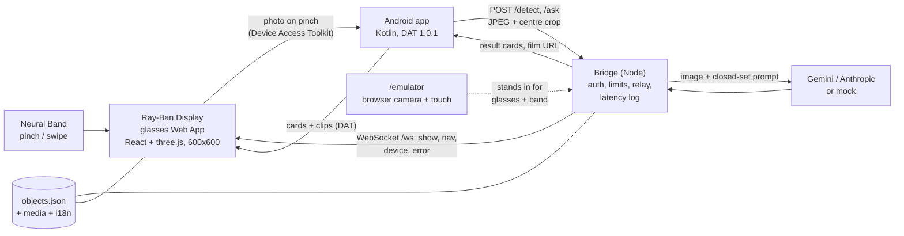

# WonderWhy

**Look at something. Ask why. See the physics drawn in your lens.**
A real-world explanation mode for **Meta Ray-Ban Display + Meta Neural Band**, built for Junction 2026 · Meta challenge *"AI Glasses for Everyone, Everyday"*.


## 60-second overview

| | |
|---|---|
| **Problem** | You are surrounded by physics you cannot see (why a kettle clicks off, what a bike's gears do). Today the answer is a phone, a search and a wall of text, and the moment is gone. |
| **Who it is for** | Curious people and learners (roughly ages 13+), especially anyone for whom a long spoken or written paragraph does not work. First venues: science centres, museums, physics classes. See [docs/USE_CASE.md](docs/USE_CASE.md). |
| **What it does** | Pinch on the Neural Band: the glasses camera takes **one photo**, the object is recognised, and a short step-by-step **line-art 3D explanation** plays on the 600 × 600 display. Swipe to change lens (Motion, Inside, Cutaway, Zoom, What if, Compare, Flow, The number), pinch to go deeper, "Turn it" to spin the live 3D model, "Listen" to hear a step. Ask a follow-up and the glasses jump to the lens that answers it. |
| **Why glasses** | The object in your hands *is* the query: no typing, no describing it. The drawing sits over the real thing in your field of view, and the wrist band keeps your hands free. A phone mirror cannot do the first-person part. |
| **Honest status** | Real Ray-Ban Display + Neural Band were used on a loaner on 14 Nov: Band pinch → glasses photo → Android → Gemini → display worked in a run, with Bluetooth drops in others. Details and what is still unverified: [Design_Handoff](Meta_Challenge/Design_Handoff.md#what-the-loaner-established), [Known limitations](#known-limitations). |

## Try it (no login, no hardware)

| What | Link |
|---|---|
| Public demo: saved explanations, no backend | <https://wonderwhy-demo.vercel.app> |
| Live camera emulator: your phone or laptop camera + touch gestures that act like the Neural Band, real bridge and model | <https://lens.167-71-139-39.sslip.io/emulator> |
| Glasses app on the live bridge (600 × 600) | <https://lens.167-71-139-39.sslip.io/> |
| Demo clips of real objects | [`DemoVideos/Objects/`](DemoVideos/Objects/) |
| Deck outline and film script | [Deck.md](Meta_Challenge/Deck.md), [Video_Script.md](Meta_Challenge/Video_Script.md) |

The emulator draws the real glasses Web App over your camera. Tap = pinch, swipe = D-pad, long press = back, round button = "Look and explain" ([bridge/README](Meta_Challenge/app/bridge/README.md#glasses-emulator-on-a-phone-emulator)). The live bridge was set to open mode for judging, so every recognition spends our Gemini credit ([deploy/README](Meta_Challenge/app/deploy/README.md)); the Vercel demo works even if that is switched off.

## How WonderWhy meets the judging criteria

### 1. Creativity and use case (25%)

| Claim | Evidence |
|---|---|
| Not "describe this photo": it **shows the hidden mechanism** as live 3D line drawings made for an additive display (black = see-through) | [3D screen spec](Meta_Challenge/app/glasses/docs/3d-screen.md), [design rules](Meta_Challenge/app/shared/DESIGN.md), 3D model schema [MODEL3D.md](Meta_Challenge/app/shared/MODEL3D.md), renderer [`app/render3d`](Meta_Challenge/app/render3d) |
| One object, several **lenses**, each answering a different question | [Modes.md](Meta_Challenge/Modes.md), library data [`objects.json`](Meta_Challenge/app/shared/objects.json): 12 objects, 44 lens chapters, 8 objects with pre-rendered films in [`bridge/media/`](Meta_Challenge/app/bridge/media) |
| First-person is the input: the photo is the question, aimed by where you look (centre crop sent as a second image) | `focusBase64` in [PROTOCOL.md](Meta_Challenge/app/shared/PROTOCOL.md); [bridge/detect.js](Meta_Challenge/app/bridge/detect.js) |
| Defined user, moment and venues | [docs/USE_CASE.md](docs/USE_CASE.md) |
| Real objects filmed for the story (printers, sauna, air bike) | [`DemoVideos/Objects/`](DemoVideos/Objects/README.md) |

### 2. Technical execution (25%)

| Claim | Evidence |
|---|---|
| Three cooperating parts: glasses Web App (React + three.js, Meta Wearables UI toolkit), Node bridge (HTTP + WebSocket), Android app (Device Access Toolkit 1.0.1) | [docs/ARCHITECTURE.md](docs/ARCHITECTURE.md), [`app/glasses`](Meta_Challenge/app/glasses), [`app/bridge`](Meta_Challenge/app/bridge), [`app/android`](Meta_Challenge/app/android) |
| Versioned wire protocol with timeouts, heartbeat, replay handover, limits | [PROTOCOL.md](Meta_Challenge/app/shared/PROTOCOL.md) |
| Handles permissions, errors, connectivity and device-state changes (take off, battery, heat, Bluetooth drop, camera denied) | [docs/UX_ACCESSIBILITY_TRUST.md](docs/UX_ACCESSIBILITY_TRUST.md#error-and-device-states), [`DeviceStates.kt`](Meta_Challenge/app/android/app/src/main/java/com/junction2026/lens/DeviceStates.kt), [`bridge.ts`](Meta_Challenge/app/glasses/src/bridge.ts) |
| Performance trade-offs measured: 30 fps scenes, lazy 3D chunk, WebGL-loss fallback, latency log with p50/p90 | [docs/ARCHITECTURE.md](docs/ARCHITECTURE.md#latency-and-performance-trade-offs), [glasses/docs/README.md](Meta_Challenge/app/glasses/docs/README.md) |
| Tests: **93** bridge tests, **172** Android JVM tests, **182** headless-browser state/scene checks | [docs/TESTING.md](docs/TESTING.md) |
| Provider switch (Gemini, Anthropic, mock) with a fully working offline/mock path | [bridge/README.md](Meta_Challenge/app/bridge/README.md) |

### 3. Real-world value and feasibility (25%)

| Claim | Evidence |
|---|---|
| Works on real hardware, with numbers: photo 5.6 s over Bluetooth, recognition 5.1 s (one successful run); film motion 1.1 s and live 3D 1.5 s after the pinch | [Design_Handoff](Meta_Challenge/Design_Handoff.md#what-the-loaner-established) |
| Feasible by design: closed-set recognition against a curated library, pre-rendered content, offline fallbacks, one cheap model call per pinch | [docs/ARCHITECTURE.md](docs/ARCHITECTURE.md), [docs/USE_CASE.md](docs/USE_CASE.md#why-this-is-feasible) |
| Content is authored as data (`render3d/specs` → `objects.json`), so a venue can add objects without new app code | [Design_Handoff "Edit and preview"](Meta_Challenge/Design_Handoff.md#edit-and-preview), [render3d/README](Meta_Challenge/app/render3d/README.md) |
| Focused adoption path: one science centre or physics class with a before/after quiz. **Planned, no pilot has run** | [docs/USE_CASE.md](docs/USE_CASE.md#adoption-and-pilot-path) |
| Deployable today: Docker + Caddy, rollback point, install QR for the glasses | [deploy/README.md](Meta_Challenge/app/deploy/README.md) |

### 4. User experience: input, accessibility and trust (25%)

| Claim | Evidence |
|---|---|
| Input for the Neural Band: pinch, four-way swipe, back; voice via the glasses' dictation (follow-up questions) and a registered "Hey Meta" tool (registration verified in Chromium; on the loaner it answered aloud without opening the visual); nothing needs a pointer | [3D screen controls](Meta_Challenge/app/glasses/docs/3d-screen.md#controls-same-in-every-state), [docs/UX_ACCESSIBILITY_TRUST.md](docs/UX_ACCESSIBILITY_TRUST.md#inputs) |
| Accessibility: captions on screen *and* "Listen" audio, 16 px minimum text, meaning never by colour alone, six languages (machine-translated), pause and hold-on-input | [docs/UX_ACCESSIBILITY_TRUST.md](docs/UX_ACCESSIBILITY_TRUST.md#accessibility), [DESIGN.md](Meta_Challenge/app/shared/DESIGN.md), [i18n](Meta_Challenge/app/shared/i18n/README.md) |
| Consent: first-run card on glasses and phone, camera only on pinch, one photo per pinch, not stored by the apps | [`App.tsx` ConsentScreen](Meta_Challenge/app/glasses/src/App.tsx), [docs/UX_ACCESSIBILITY_TRUST.md](docs/UX_ACCESSIBILITY_TRUST.md#consent-and-data) |
| Trust: "Not sure" card below 0.6 confidence, unknown objects flagged *unverified*, stand-in models tagged | [PROTOCOL.md](Meta_Challenge/app/shared/PROTOCOL.md) (`lowConfidence`, `standIn`), [bridge/sketch.js](Meta_Challenge/app/bridge/sketch.js) |
| Every error and device state has a screenshot | [`glasses/docs/states/`](Meta_Challenge/app/glasses/docs/states), [`android/docs/screens/`](Meta_Challenge/app/android/docs/screens) |

## Architecture



Details, data flow and failure handling: [docs/ARCHITECTURE.md](docs/ARCHITECTURE.md).

## Repo map

| Path | What |
|---|---|
| [`docs/`](docs/) | Judge-facing docs: [USE_CASE](docs/USE_CASE.md), [ARCHITECTURE](docs/ARCHITECTURE.md), [UX_ACCESSIBILITY_TRUST](docs/UX_ACCESSIBILITY_TRUST.md), [TESTING](docs/TESTING.md) |
| [`Meta_Challenge/app/glasses`](Meta_Challenge/app/glasses) | Glasses Web App (Vite, React, three.js) and its [state-check report](Meta_Challenge/app/glasses/docs/README.md) |
| [`Meta_Challenge/app/bridge`](Meta_Challenge/app/bridge) | Node bridge: detection, follow-up `/ask`, relay, latency log; serves the glasses app, `/phone` and `/emulator`; 10 test files |
| [`Meta_Challenge/app/android`](Meta_Challenge/app/android) | Android app on the Meta Wearables Device Access Toolkit, [screenshots](Meta_Challenge/app/android/docs/screens) |
| [`Meta_Challenge/app/render3d`](Meta_Challenge/app/render3d) | three.js renderer for the "Explore" films and stills, object specs |
| [`Meta_Challenge/app/shared`](Meta_Challenge/app/shared) | `objects.json` library, [PROTOCOL](Meta_Challenge/app/shared/PROTOCOL.md), [DESIGN](Meta_Challenge/app/shared/DESIGN.md), [MODEL3D](Meta_Challenge/app/shared/MODEL3D.md), [i18n](Meta_Challenge/app/shared/i18n/README.md) |
| [`Meta_Challenge/app/deploy`](Meta_Challenge/app/deploy) | Dockerfile, Caddy block, `deploy.sh`, install QR |
| [`Meta_Challenge/`](Meta_Challenge/README.md) | Product docs: [Brief](Meta_Challenge/Brief.md), [Modes](Meta_Challenge/Modes.md), [Submission](Meta_Challenge/Submission.md), [Deck](Meta_Challenge/Deck.md), [Design_Handoff](Meta_Challenge/Design_Handoff.md), [Glasses_Test](Meta_Challenge/Glasses_Test.md), video notes |
| [`Meta_Challenge/team-notes/`](Meta_Challenge/team-notes/README.md) | Internal hackathon logistics (plan, booth questions, hand-overs). Not needed to judge |
| [`Meta_Challenge/video`](Meta_Challenge/video) | The WonderWhy film pipeline: AR renders, cuts, voice auditions |
| [`DemoVideos/Objects/`](DemoVideos/Objects/) | Raw footage of real objects |
| [`scripts/check-md-links.mjs`](scripts/check-md-links.mjs) | Checks every relative Markdown link resolves |

## Run it locally (about 2 minutes)

Needs Node 20+. No API key is needed for the library objects (the bridge falls back to a mock provider).

```bash
cd Meta_Challenge/app/glasses && npm ci && npm run build
cd ../bridge && npm ci && npm start
```

| Open | What |
|---|---|
| <http://localhost:8787/> | Glasses app (arrows = D-pad, Enter = pinch, Esc = back) |
| <http://localhost:8787/phone> | Phone stand-in: webcam, pinch, object buttons, languages |
| <http://localhost:8787/emulator> | Camera emulator (browsers allow the camera on `localhost` or HTTPS only) |
| <http://localhost:8787/health> | Provider and auth status |

Real recognition needs a key: copy `bridge/.env.example` to `bridge/.env` and set `GEMINI_API_KEY` or `ANTHROPIC_API_KEY` (never commit `.env`). Set `LENS_TOKEN` to lock the bridge. Android build and emulator notes: [android/README](Meta_Challenge/app/android/README.md). 3D renders: [render3d/README](Meta_Challenge/app/render3d/README.md).

## Tests

```bash
cd Meta_Challenge/app/bridge && npm test            # 93 tests, no network or key needed
cd ../glasses && npm run build                      # type-check + production build
cd ../glasses && npm run test:states                # headless-Chrome state and scene suite (needs Playwright browsers)
node Meta_Challenge/app/shared/i18n/check.mjs       # translation checker (from the repo root)
node scripts/check-md-links.mjs                     # docs link check (from the repo root)
```

Android: `./gradlew testDebugUnitTest` in `Meta_Challenge/app/android` (JDK 17 + Android SDK). Results and caveats: [docs/TESTING.md](docs/TESTING.md).

## Team

| Who | GitHub |
|---|---|
| Alex | [MrNetwork](https://github.com/mrnetwork0001) |
| IceFrost | [IceFrosst](https://github.com/IceFrosst) |
| IdelicMemor | IdelicMemor |

## Known limitations

We would rather you read these here than discover them.

| Area | Limitation |
|---|---|
| Real hardware | Verified on a loaner, in single runs only: Bluetooth dropped right after photo delivery in other attempts. Continuous drag, frame rate and long sessions on the glasses are **not measured**; audio routing and native MP4 playback on the glasses still need a listening and motion check. |
| Latency | Pinch to explanation is several seconds on the real path (photo transfer 5.6 s + recognition 5.1 s in the one successful run). Pre-rendered content makes everything after recognition fast. |
| Recognition | Closed set: 12 library objects. Anything else gets "Not sure" or, if enabled, a generated sketch marked *unverified*. Detection accuracy has no published benchmark; the earlier benchmark used a stand-in model. |
| Translations | Finnish, Swedish, German, Spanish and French are machine-made, not read by native speakers. `i18n/check.mjs` currently **fails**: the files lag the library (5 newer objects and the phone Explore chapter fall back to English). Button labels such as "Pause" and "Listen" stay English. |
| Accessibility | No `prefers-reduced-motion` handling yet (Pause button and hold-on-input exist); no testing with disabled users; speech uses the browser voice. |
| Privacy | The photo is sent to the model provider (Gemini on the live bridge). The apps and bridge do not store it, but we have not audited the provider's retention. The live bridge is open for judging (no token), with a cap of 4 concurrent model calls and no per-user rate limit. |
| Physics accuracy | Library captions were fact-checked by the team and an independent pass; generated sketches and free-form model answers are not checked. |
| Pilot | No pilot has run. The pilot plan is a proposal. |
| Platform | Android only (no iOS build). Web Apps on the Display get no camera, so the phone app is part of the capture path. |
| Older docs | Some documents under `Meta_Challenge/` record the state at a given hour on 13 to 15 Nov (for example "7 objects", "nothing has run on real glasses") and carry status notes where they were superseded. `docs/` and this README are current. |

## About this repo

Extracted, with history, from the team monorepo [IceFrosst/Junction-2026](https://github.com/IceFrosst/Junction-2026) (only the Meta glasses project paths were kept). A few notes refer to research that stayed there and are marked *(internal note, not in this repo)*. Licensed under [MIT](LICENSE).
