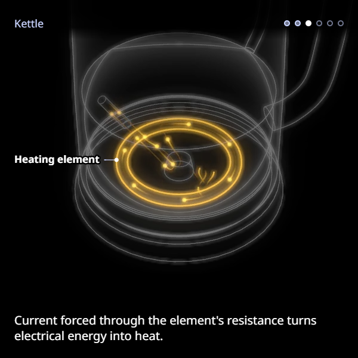
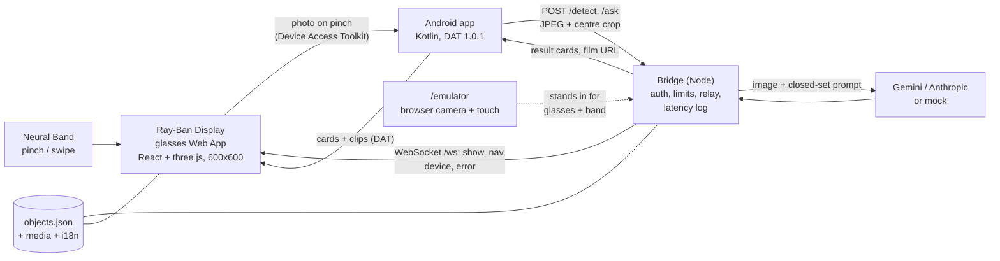

# WonderWhy

**Look at something. Ask why. See the physics drawn in your lens.** *Curiosity and learning everyday unleashed.*
A real-world explanation mode for **Meta Ray-Ban Display + Meta Neural Band**, built for Junction 2026 · Meta challenge *"AI Glasses for Everyone, Everyday"*.

*Naming: the product is **WonderWhy**. Its first working name was Physics Lens, and a few code and tool identifiers (the installed app label, the "Hey Meta" tool name, the install deep link) still say "Physics Lens".*

> Curiosity usually dies in three seconds. You see something and wonder how it works, but looking it up means stopping, taking out your phone... So you don't.
>
> WonderWhy closes that gap. Look at anything, ask why, and a 3D explanation of the physics behind it appears in your AR glasses. Curiosity becomes understanding before the moment passes.
>
> **Curiosity and learning everyday unleashed.**

**Watch the film (1:24):** [`WonderWhy_final_A2.mp4`](Meta_Challenge/video/renders/WonderWhy_final_A2.mp4) (1080p, 58 MB, compressed from the master render).



## 60-second overview

| | |
|---|---|
| **Problem** | You are surrounded by physics you cannot see (why a kettle clicks off, what a bike's gears do). Today the answer is a phone, a search and a wall of text, and the moment is gone. |
| **Who it is for** | Curious people and learners (roughly ages 13+), especially anyone for whom a long spoken or written paragraph does not work. First venues: science centres, museums, physics classes. See [docs/USE_CASE.md](docs/USE_CASE.md). |
| **What it does** | Pinch on the Neural Band: the glasses camera takes **one photo**, the object is recognised (about 2 s), and a short step-by-step **line-art 3D explanation** plays on the 600 × 600 display. Swipe to change lens (Motion, Inside, Cutaway, Zoom, What if, Compare, Flow, The number), pinch to go deeper, "Turn it" to spin the live 3D model, "Listen" to hear a step. Ask a follow-up and the glasses jump to the lens that answers it. |
| **Coverage** | **12 library objects** (pre-built, instant), **and any other object works**: recognition takes about 2 s, then for an object outside the library the bridge generates a live 3D explanation from the photo and your voice question. That takes about a minute (one measured run: 57 s), and the result is marked *unverified*. See [how coverage works](#what-works-on-which-objects). |
| **Why glasses** | The object in your hands *is* the query: no typing, no describing it. The drawing sits over the real thing in your field of view, and the wrist band keeps your hands free. A phone mirror cannot do the first-person part. |
| **Honest status** | Real Ray-Ban Display + Neural Band were used on a loaner on 14 Nov: Band pinch → glasses photo → Android → Gemini → display worked in a run, with Bluetooth drops in others. Details and what is still unverified: [Design_Handoff](Meta_Challenge/Design_Handoff.md#what-the-loaner-established), [Known limitations](#known-limitations). |

## Try it (no login, no hardware)

| What | Link |
|---|---|
| **1. Live camera emulator (start here)**: your phone or laptop camera passes through, with the real glasses Web App and its live 3D line renders drawn over it, and touch gestures that act like the Neural Band. Real bridge and model | <https://lens.167-71-139-39.sslip.io/emulator> |
| 2. Glasses app on the live bridge (open at 600 × 600) | <https://lens.167-71-139-39.sslip.io/> |
| **The film (1:24, 1080p)** | [`WonderWhy_final_A2.mp4`](Meta_Challenge/video/renders/WonderWhy_final_A2.mp4) (earlier cuts: [`video/renders/`](Meta_Challenge/video/renders/README.md)) |
| Pitch deck (PDF, 8 slides) | [`WonderWhy_Deck.pdf`](Meta_Challenge/deck/WonderWhy_Deck.pdf) (outline: [Deck.md](Meta_Challenge/Deck.md)) |
| Demo clips of real objects (raw footage, no app overlay) | [`DemoVideos/Objects/`](DemoVideos/Objects/) |
| Film script | [Video_Script.md](Meta_Challenge/Video_Script.md) |

**How to use the emulator (3 steps)**

1. Open the emulator link on a phone or laptop and allow the camera. Read the start screen's privacy notice, then start.
2. Point the camera at a library object (kettle, guitar, ball, bicycle, metal spoon, phone, earbuds, pendulum) and press the round **Look and explain** button. That is the Band pinch: one photo is taken and the object is recognised.
3. Use gestures like the Neural Band: **tap** = pinch (next step, go deeper), **swipe** = D-pad (change lens, turn the live 3D model), **long press** = back. Details: [bridge/README](Meta_Challenge/app/bridge/README.md#glasses-emulator-on-a-phone-emulator).

The live bridge is **open for judging** (no token) with a per-IP rate limit (10 requests per minute and 100 per hour per IP on the live server), and will be re-locked after judging ([deploy/README](Meta_Challenge/app/deploy/README.md)). Every recognition spends our Gemini credit, and a generated 3D explanation for an unknown object costs far more than a recognition ([estimates](docs/USE_CASE.md#feasibility-and-cost)), so please do not script it. If recognition is unavailable, pick an object by hand in the glasses app (link 2): the library art needs no model.

### What works on which objects

| Object | What happens | Time | Status |
|---|---|---|---|
| One of the **12 library objects** (kettle, guitar, ball, bicycle, metal spoon, phone, earbuds, pendulum display glasses, spin bike, sauna stove and 3D printer) | Recognised, then the pre-built lenses and films play | Recognition about 2 s (`gemini-3.6-flash`, team-measured on the server: 1.6 to 2.2 s detect for the sauna and printer photos, 15 Nov; not logged in this repo); everything after is instant | Physics captions checked by the team and an independent pass |
| **Any other object** | Recognised, then the bridge generates a live 3D explanation (`SKETCH_PROVIDER=auto`, model `gemini-4-carbon` via `SKETCH_MODEL`) from the photo and, when the client sends one, the voice question; the glasses show "Drawing a sketch…" while it runs | About a minute: **57 s** measured for a pair of glasses (15 Nov); a flash-class model measured 19.5 s | Marked **unverified**: the numbers are the model's estimates, not checked facts |

The two figures for generated explanations are single runs on the live server, not a benchmark. The 57 s carbon figure is from a direct sketch test on 15 Nov. Runs with the real glasses on the live generation (the owner tested it once, Alex twice) are **owner-reported** and not logged in this repo. The carbon figure is also recorded in the message of team-repo commit [`fd04c8e`](https://github.com/IceFrosst/Junction-2026/commit/fd04c8e); the 19.5 s flash figure and the 2 s recognition figure are team measurements on the server, with no log file in this repo. Wire format: [PROTOCOL "Sketch for an unknown object"](Meta_Challenge/app/shared/PROTOCOL.md).

## How WonderWhy meets the judging criteria

### 1. Creativity and use case (25%)

| Claim | Evidence |
|---|---|
| Not "describe this photo": it **shows the hidden mechanism** as live 3D line drawings made for an additive display (black = see-through) | [3D screen spec](Meta_Challenge/app/glasses/docs/3d-screen.md), [design rules](Meta_Challenge/app/shared/DESIGN.md), 3D model schema [MODEL3D.md](Meta_Challenge/app/shared/MODEL3D.md), renderer [`app/render3d`](Meta_Challenge/app/render3d) |
| One object, several **lenses**, each answering a different question | [Modes.md](Meta_Challenge/Modes.md), library data [`objects.json`](Meta_Challenge/app/shared/objects.json): 12 library objects, 44 lens chapters, 8 objects with pre-rendered films in [`bridge/media/`](Meta_Challenge/app/bridge/media); any other object gets a generated, *unverified* 3D explanation |
| First-person is the input: the photo is the question, aimed by where you look (centre crop sent as a second image) | `focusBase64` in [PROTOCOL.md](Meta_Challenge/app/shared/PROTOCOL.md); [bridge/detect.js](Meta_Challenge/app/bridge/detect.js) |
| Defined user, moment and venues | [docs/USE_CASE.md](docs/USE_CASE.md) |
| Real objects filmed for the story (printers, sauna, air bike; raw footage, no app overlay) | [`DemoVideos/Objects/`](DemoVideos/Objects/README.md) |

### 2. Technical execution (25%)

| Claim | Evidence |
|---|---|
| Three cooperating parts: glasses Web App (React + three.js, Meta Wearables UI toolkit), Node bridge (HTTP + WebSocket), Android app (Device Access Toolkit 1.0.1) | [docs/ARCHITECTURE.md](docs/ARCHITECTURE.md), [`app/glasses`](Meta_Challenge/app/glasses), [`app/bridge`](Meta_Challenge/app/bridge), [`app/android`](Meta_Challenge/app/android) |
| Versioned wire protocol with timeouts, heartbeat, replay handover, limits | [PROTOCOL.md](Meta_Challenge/app/shared/PROTOCOL.md) |
| Handles permissions, errors, connectivity and device-state changes (take off, battery, heat, Bluetooth drop, camera denied) | [docs/UX_ACCESSIBILITY_TRUST.md](docs/UX_ACCESSIBILITY_TRUST.md#error-and-device-states), [`DeviceStates.kt`](Meta_Challenge/app/android/app/src/main/java/com/junction2026/lens/DeviceStates.kt), [`bridge.ts`](Meta_Challenge/app/glasses/src/bridge.ts) |
| Performance trade-offs measured: 30 fps scenes (desktop headless Chrome, not the glasses), lazy 3D chunk, WebGL-loss fallback, latency log with p50/p90 | [docs/ARCHITECTURE.md](docs/ARCHITECTURE.md#latency-and-performance-trade-offs), [glasses/docs/README.md](Meta_Challenge/app/glasses/docs/README.md) |
| Tests: **101** bridge tests, **172** Android JVM tests, **182** headless-browser state/scene checks | [docs/TESTING.md](docs/TESTING.md) |
| How we built it and how much we tested on real devices (commit history, test counts, real-device sessions, with what is team-reported rather than verifiable) | [docs/BUILD_STORY.md](docs/BUILD_STORY.md) |
| Provider switch (Gemini, Anthropic, mock) with a fully working offline/mock path | [bridge/README.md](Meta_Challenge/app/bridge/README.md) |

### 3. Real-world value and feasibility (25%)

| Claim | Evidence |
|---|---|
| Works on real hardware, with numbers from **one** successful loaner run (14 Nov): photo to phone 5.6 s over Bluetooth; film motion 1.1 s and live 3D 1.5 s after the pinch. Recognition today: model `gemini-3.6-flash` (since 15 Nov about 08:25), **about 1.6 to 2.2 s detect time measured on the server** for the sauna and printer photos (team benchmark, not logged in this repo); end to end depends on the network | [Design_Handoff](Meta_Challenge/Design_Handoff.md#what-the-loaner-established) |
| Feasible by design: recognition against a curated library with pre-rendered content and offline fallbacks (one cheap model call per library pinch); anything outside the library gets a slower generated explanation. Approximate cost per use is in the [cost table](docs/USE_CASE.md#feasibility-and-cost) | [docs/ARCHITECTURE.md](docs/ARCHITECTURE.md), [docs/USE_CASE.md](docs/USE_CASE.md#why-this-is-feasible) |
| Content is authored as data (`render3d/specs` → `objects.json`), so a venue can add objects without new app code | [Design_Handoff "Edit and preview"](Meta_Challenge/Design_Handoff.md#edit-and-preview), [render3d/README](Meta_Challenge/app/render3d/README.md) |
| Focused adoption path: one science centre or physics class with a before/after quiz. **Planned, no pilot has run** | [docs/USE_CASE.md](docs/USE_CASE.md#adoption-and-pilot-path) |
| Deployable today: Docker + Caddy, rollback point, install QR for the glasses | [deploy/README.md](Meta_Challenge/app/deploy/README.md) |

### 4. User experience: input, accessibility and trust (25%)

| Claim | Evidence |
|---|---|
| Input for the Neural Band: pinch, four-way swipe, back; voice via the glasses' dictation (follow-up questions) and a registered "Hey Meta" tool (registration verified in Chromium; on the loaner it answered aloud without opening the visual); nothing needs a pointer | [3D screen controls](Meta_Challenge/app/glasses/docs/3d-screen.md#controls-same-in-every-state), [docs/UX_ACCESSIBILITY_TRUST.md](docs/UX_ACCESSIBILITY_TRUST.md#inputs) |
| Accessibility: captions on screen *and* "Listen" audio, 16 px minimum text, meaning never by colour alone, six languages (machine-translated), pause and hold-on-input | [docs/UX_ACCESSIBILITY_TRUST.md](docs/UX_ACCESSIBILITY_TRUST.md#accessibility), [DESIGN.md](Meta_Challenge/app/shared/DESIGN.md), [i18n](Meta_Challenge/app/shared/i18n/README.md) |
| Consent: first-run card on glasses and phone, and a start screen with a privacy notice on the emulator (no photo is sent before you start). The glasses card names Gemini, says the photo is not stored and asks wearers not to point at people. Camera only on pinch, one photo per pinch | [`App.tsx` ConsentScreen](Meta_Challenge/app/glasses/src/App.tsx), [`emulator.html`](Meta_Challenge/app/bridge/public/emulator.html), [docs/UX_ACCESSIBILITY_TRUST.md](docs/UX_ACCESSIBILITY_TRUST.md#consent-and-data) |
| Trust: "Not sure" card below 0.6 confidence, generated explanations for unknown objects flagged *unverified*, stand-in models tagged, per-IP rate limit on model-spending routes (10/min, 100/hour on the live server) | [PROTOCOL.md](Meta_Challenge/app/shared/PROTOCOL.md) (`lowConfidence`, `standIn`), [bridge/sketch.js](Meta_Challenge/app/bridge/sketch.js), [bridge README](Meta_Challenge/app/bridge/README.md) (`LENS_RATE_PER_MIN`, `LENS_RATE_PER_HOUR`) |
| Every error and device state has a screenshot | [`glasses/docs/states/`](Meta_Challenge/app/glasses/docs/states), [`android/docs/screens/`](Meta_Challenge/app/android/docs/screens) |

## Architecture



Details, data flow and failure handling: [docs/ARCHITECTURE.md](docs/ARCHITECTURE.md).

## Repo map

| Path | What |
|---|---|
| [`docs/`](docs/) | Judge-facing docs: [USE_CASE](docs/USE_CASE.md), [ARCHITECTURE](docs/ARCHITECTURE.md), [UX_ACCESSIBILITY_TRUST](docs/UX_ACCESSIBILITY_TRUST.md), [TESTING](docs/TESTING.md), [BUILD_STORY](docs/BUILD_STORY.md) |
| [`Meta_Challenge/app/glasses`](Meta_Challenge/app/glasses) | Glasses Web App (Vite, React, three.js) and its [state-check report](Meta_Challenge/app/glasses/docs/README.md) |
| [`Meta_Challenge/app/bridge`](Meta_Challenge/app/bridge) | Node bridge: detection, follow-up `/ask`, relay, latency log; serves the glasses app, `/phone` and `/emulator`; rate limit; 11 test files |
| [`Meta_Challenge/app/android`](Meta_Challenge/app/android) | Android app on the Meta Wearables Device Access Toolkit, [screenshots](Meta_Challenge/app/android/docs/screens) |
| [`Meta_Challenge/app/render3d`](Meta_Challenge/app/render3d) | three.js renderer for the "Explore" films and stills, object specs |
| [`Meta_Challenge/app/shared`](Meta_Challenge/app/shared) | `objects.json` library, [PROTOCOL](Meta_Challenge/app/shared/PROTOCOL.md), [DESIGN](Meta_Challenge/app/shared/DESIGN.md), [MODEL3D](Meta_Challenge/app/shared/MODEL3D.md), [i18n](Meta_Challenge/app/shared/i18n/README.md) |
| [`Meta_Challenge/app/deploy`](Meta_Challenge/app/deploy) | Dockerfile, Caddy block, `deploy.sh`, install QR |
| [`Meta_Challenge/`](Meta_Challenge/README.md) | Product docs: [Brief](Meta_Challenge/Brief.md), [Modes](Meta_Challenge/Modes.md), [Submission](Meta_Challenge/Submission.md), [Deck](Meta_Challenge/Deck.md), [Design_Handoff](Meta_Challenge/Design_Handoff.md), [Glasses_Test](Meta_Challenge/Glasses_Test.md), video notes |
| [`Meta_Challenge/team-notes/`](Meta_Challenge/team-notes/README.md) | Internal hackathon logistics (plan, booth questions, hand-overs). Not needed to judge |
| [`Meta_Challenge/video`](Meta_Challenge/video) | The WonderWhy film pipeline: AR renders, cuts, voice auditions |
| [`Meta_Challenge/deck/`](Meta_Challenge/deck) | Pitch deck: [`WonderWhy_Deck.pdf`](Meta_Challenge/deck/WonderWhy_Deck.pdf), its HTML source and emulator QR |
| [`DemoVideos/Objects/`](DemoVideos/Objects/) | Raw filmed footage of real objects, used for the film (no app overlay) |
| [`scripts/check-md-links.mjs`](scripts/check-md-links.mjs) | Checks every relative Markdown link resolves |

## Run it locally (about 2 minutes)

Needs Node 20+. No API key is needed for the library objects (the bridge falls back to a mock provider).

```bash
cd Meta_Challenge/app/glasses && npm ci && npm run build
cd ../bridge && npm ci && npm start
```

| Open | What |
|---|---|
| <http://localhost:8787/> | Glasses app (arrows = D-pad, Enter = pinch, Esc = back) |
| <http://localhost:8787/phone> | Phone stand-in: webcam, pinch, object buttons, languages |
| <http://localhost:8787/emulator> | Camera emulator (browsers allow the camera on `localhost` or HTTPS only) |
| <http://localhost:8787/health> | Provider and auth status |

Real recognition needs a key: copy `bridge/.env.example` to `bridge/.env` and set `GEMINI_API_KEY` or `ANTHROPIC_API_KEY` (never commit `.env`). Set `LENS_TOKEN` to lock the bridge. Android build and emulator notes: [android/README](Meta_Challenge/app/android/README.md). 3D renders: [render3d/README](Meta_Challenge/app/render3d/README.md).

## Tests

```bash
cd Meta_Challenge/app/bridge && npm test            # 101 tests, no network or key needed
cd ../glasses && npm run build                      # type-check + production build
cd ../glasses && npm run test:states                # headless-Chrome state and scene suite (needs Playwright browsers)
node Meta_Challenge/app/shared/i18n/check.mjs       # translation checker (from the repo root)
node scripts/check-md-links.mjs                     # docs link check (from the repo root)
```

Android: `./gradlew testDebugUnitTest` in `Meta_Challenge/app/android` (JDK 17 + Android SDK). Results and caveats: [docs/TESTING.md](docs/TESTING.md).

## Team

| Who | GitHub |
|---|---|
| Alex | [MrNetwork](https://github.com/mrnetwork0001) |
| IceFrost | [IceFrosst](https://github.com/IceFrosst) |
| IdelicMemor | IdelicMemor |

## Known limitations

We would rather you read these here than discover them.

| Area | Limitation |
|---|---|
| Real hardware | Verified on a loaner, in single runs only: Bluetooth dropped right after photo delivery in other attempts. Continuous drag, frame rate and long sessions on the glasses are **not measured**; audio routing and native MP4 playback on the glasses still need a listening and motion check. |
| Latency | Library objects: pinch to explanation is several seconds on the real path: in the one successful loaner run the photo took 5.6 s to reach the phone over Bluetooth, and that run's recognition (an earlier model setting) is not comparable to today's. The live bridge now uses `gemini-3.6-flash` (the earlier `gemini-3.5-flash` is deprecated and routed to it by Google): about 1.6 to 2.2 s detect time measured **on the server** (15 Nov, sauna and printer photos; 1.4 to 2.1 s on 3.5-flash), so end-to-end time depends on the network. Pre-rendered content makes everything after recognition fast. Objects outside the library take about a minute for the generated explanation (57 s measured with `gemini-4-carbon` in a direct sketch test on 15 Nov, 19.5 s with a flash-class model); there is no cache, so the same object is generated again each time. Each generation costs about $0.10 on the live bridge (owner/team-observed; our estimate band is $0.084 to $0.124), expected to fall with caching and smaller models but not guaranteed: see [Cost trend](docs/USE_CASE.md#cost-trend). |
| Recognition | 12 library objects have checked, pre-built explanations. Any other object is recognised (about 2 s) and then gets a generated 3D explanation that takes about a minute (57 s in one measured run) and is marked *unverified*; below 0.6 confidence the app says "Not sure" instead. Detection accuracy has no published benchmark; the earlier benchmark used a stand-in model, and the generated explanations were not accuracy-tested. |
| Translations | Finnish, Swedish, German, Spanish and French are machine-made, not read by native speakers. `i18n/check.mjs` currently **fails**: the files lag the library (5 newer objects and the phone Explore chapter fall back to English). Button labels such as "Pause" and "Listen" stay English. |
| Accessibility | No `prefers-reduced-motion` handling yet (Pause button and hold-on-input exist); no testing with disabled users; speech uses the browser voice. |
| Privacy | The photo is sent to the model provider (Gemini on the live bridge). The apps and bridge do not store it, but we have not audited the provider's retention. The live bridge is open for judging (no token), with a per-IP rate limit (10 per minute, 100 per hour) and a cap of 4 concurrent model calls; it will be re-locked after judging. See [bystander privacy and consent](docs/UX_ACCESSIBILITY_TRUST.md#bystander-privacy-and-consent). |
| Physics accuracy | Library captions were fact-checked by the team and an independent pass; generated sketches and free-form model answers are not checked. |
| Pilot | No pilot has run. The pilot plan is a proposal; no venue has been contacted. |
| Platform | Android only (no iOS build). Web Apps on the Display get no camera, so the phone app is part of the capture path. |
| Older docs | Some documents under `Meta_Challenge/` record the state at a given hour on 13 to 15 Nov (for example "7 objects", "nothing has run on real glasses") and carry status notes where they were superseded. `docs/` and this README are current. |

## About this repo

Extracted, with history, from the team monorepo [IceFrosst/Junction-2026](https://github.com/IceFrosst/Junction-2026) (only the Meta glasses project paths were kept). A few notes refer to research that stayed there and are marked *(internal note, not in this repo)*. Licensed under [MIT](LICENSE).
