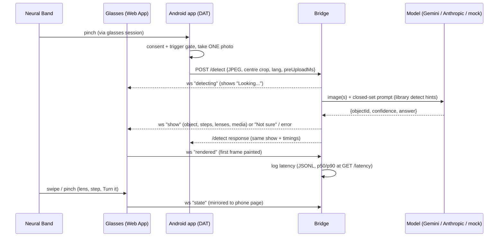

# Architecture

[← README](../README.md) · [Use case](USE_CASE.md) · [UX, accessibility and trust](UX_ACCESSIBILITY_TRUST.md) · [Testing](TESTING.md)

## Components

| Component | Path | Role | Tech |
|---|---|---|---|
| Glasses Web App | [`Meta_Challenge/app/glasses`](../Meta_Challenge/app/glasses) | The UI on the Ray-Ban Display: home, consent, explainer (lenses), 3D film, "Turn it", Ask, status and error cards | Vite, React 19, three.js 0.170, `@wearables-ui-toolkit/mrbd` ([`wearables.config.json`](../Meta_Challenge/app/glasses/wearables.config.json)) |
| Bridge | [`Meta_Challenge/app/bridge`](../Meta_Challenge/app/bridge) | Recognition (`/detect`), follow-ups (`/ask`), WebSocket relay, auth and limits, latency log; also serves the built glasses app, `/media/*`, `/phone`, `/emulator` | Node (one dependency: `ws`), [`server.js`](../Meta_Challenge/app/bridge/server.js), [`detect.js`](../Meta_Challenge/app/bridge/detect.js), [`ask.js`](../Meta_Challenge/app/bridge/ask.js), [`sketch.js`](../Meta_Challenge/app/bridge/sketch.js) |
| Android app | [`Meta_Challenge/app/android`](../Meta_Challenge/app/android) | Owns the glasses session and capture through the Device Access Toolkit: Band input, one photo per pinch, upload, result cards and clips on the display, device-state cards, offline cards, consent | Kotlin, Meta DAT 1.0.1 ([`GlassesController.kt`](../Meta_Challenge/app/android/app/src/main/java/com/junction2026/lens/GlassesController.kt), [`MainActivity.kt`](../Meta_Challenge/app/android/app/src/main/java/com/junction2026/lens/MainActivity.kt)) |
| 3D renderer | [`Meta_Challenge/app/render3d`](../Meta_Challenge/app/render3d) | Builds the "Explore" films, stills and tracks from object specs; its geometry code is reused live by the Web App (`@r3d` alias in [`vite.config.ts`](../Meta_Challenge/app/glasses/vite.config.ts)) | three.js, headless Chrome, FFmpeg |
| Shared contract | [`Meta_Challenge/app/shared`](../Meta_Challenge/app/shared) | [`objects.json`](../Meta_Challenge/app/shared/objects.json) (library), [PROTOCOL.md](../Meta_Challenge/app/shared/PROTOCOL.md), [MODEL3D.md](../Meta_Challenge/app/shared/MODEL3D.md), [i18n](../Meta_Challenge/app/shared/i18n/README.md) | JSON, Markdown |
| Browser stand-ins | [`bridge/public/phone.html`](../Meta_Challenge/app/bridge/public/phone.html), [`emulator.html`](../Meta_Challenge/app/bridge/public/emulator.html) | `/phone` stands in for the phone app; `/emulator` draws the real Web App over the browser camera and maps touch to Band gestures | Plain HTML/JS |
| Deploy | [`Meta_Challenge/app/deploy`](../Meta_Challenge/app/deploy) | One container (bridge + built Web App) behind Caddy HTTPS | Docker, Caddy ([Dockerfile](../Meta_Challenge/app/deploy/Dockerfile)) |

## Data flow in words

1. **Capture.** The Android app decides if a trigger may run ([`TriggerGate.kt`](../Meta_Challenge/app/android/app/src/main/java/com/junction2026/lens/TriggerGate.kt): not connected, blocked, display not ready, busy, or consent first), takes one photo through the DAT session and also crops the middle 50% of each side as a second image.
2. **Recognise.** `POST /detect` ([`server.js`](../Meta_Challenge/app/bridge/server.js) `handleDetect`) sends both images and a prompt built from the library (`buildPrompt` in `detect.js`). The model must answer with one library `objectId` or `unknown`, plus a confidence and a short answer. The bridge cleans and caps the answer (14 words).
3. **Decide.** Below `MIN_CONFIDENCE` (0.6) the bridge marks `lowConfidence` and clients show "Not sure" instead of a scene. `unknown` shows the model's short text, or, if `SKETCH_PROVIDER` is on, a generated sketch tagged `verified: false`.
4. **Show.** A `show` message goes to the glasses over WebSocket and back to the phone app. It carries the object's one-line answer, the lens list with step captions, and a media manifest. The Web App plays the pre-rendered Explore film (labels and captions drawn on top from `tracks.json`) or draws a 2D scene.
5. **Navigate.** Band input runs inside the Web App (pinch, swipe, back). A phone or emulator can drive the same actions with `nav` messages.
6. **Follow up.** `POST /ask` answers a question about a library object and returns the best lens and step; with no model it falls back to word matching against captions ([`ask.js`](../Meta_Challenge/app/bridge/ask.js)).

Two capture routes exist: the **native** route above (Android shows cards, and an Explore clip, on the display), and the **Web App** route where the Web App is in front and its "Take photo" button asks the phone to capture through the bridge (`GET /capture`, see [Design_Handoff](../Meta_Challenge/Design_Handoff.md#what-the-loaner-established) for what was verified and what was not).

## Protocol

Full contract: [PROTOCOL.md](../Meta_Challenge/app/shared/PROTOCOL.md). Fields are only ever added, never renamed.

| Message | Direction | Purpose |
|---|---|---|
| `POST /detect`, `/ask`, `/rendered` | phone → bridge | Recognise, follow up, report paint time |
| `detecting`, `show`, `nav`, `clear`, `device`, `error`, `ping` | bridge → glasses (WebSocket `/ws`) | State of a request, content, input from another client, device state, short error card |
| `hello`, `rendered`, `state` | glasses → bridge | Register, report first paint, mirror what the wearer sees |
| `GET /last` and replay on `hello` | bridge → late client | A Web App opened up to 120 s after a detect lands on the same scene |
| `GET /health`, `/objects?lang=`, `/latency`, `/media/*` | any | Status, localized library, p50/p90, assets |

## Model providers

| Provider | When | Notes |
|---|---|---|
| `gemini` | Live bridge ([deploy README](../Meta_Challenge/app/deploy/README.md)) | Key in header; thinking tokens count against the output cap, so the cap is at least 4096 ([`callGemini`](../Meta_Challenge/app/bridge/detect.js)) |
| `anthropic` | If `ANTHROPIC_API_KEY` is set (takes precedence when both keys exist) | Same prompt and JSON contract |
| `mock` | No key | Library objects by `forceObjectId` and word matching; used by tests and the offline demo |
| `pi`, `claude` | Developer machines only | Run a local CLI with that person's login; answers carry `standIn: true`, clients show a "Stand-in model" tag, never run on the server |

Selection: `DETECT_PROVIDER`, else Anthropic if a key exists, else Gemini if a key exists, else mock ([`pickProvider`](../Meta_Challenge/app/bridge/detect.js)). Paid providers refuse to start without `LENS_TOKEN` unless `LENS_ALLOW_OPEN=1` is set; the live bridge currently runs open for judging (see [UX, accessibility and trust](UX_ACCESSIBILITY_TRUST.md#consent-and-data)). Env table: [bridge README](../Meta_Challenge/app/bridge/README.md#env-copy-envexample-to-env).

## Latency and performance trade-offs

| Trade-off | Decision | Where |
|---|---|---|
| Generate vs pre-render | Content is **pre-rendered** (6.8 s, 600 × 600, 30 fps clips; the kettle film is 6 clips, 1.51 MB). The model only picks the object and answers questions, so the slow part is one short call, not video generation | [Design_Handoff baseline](../Meta_Challenge/Design_Handoff.md#baseline-to-compare-against), [`bridge/media`](../Meta_Challenge/app/bridge/media) |
| Live 3D vs bundle size | "Turn it" is built live from the model spec in a **lazy** chunk (fetched about 3 s into the film). Renders only while something moves, pixel ratio 1, no bloom, shadows off | [3D screen](../Meta_Challenge/app/glasses/docs/3d-screen.md#turn-it) |
| WebGL risk | On WebGL failure or context loss the beat's clean still and "3D view unavailable" are shown; `?live3d=0` forces it; two 72-angle atlases are the older fallback | [3D screen](../Meta_Challenge/app/glasses/docs/3d-screen.md), state `43-explore-fallback` |
| First load | Budget: 300 KB gzip, 15 requests ([DESIGN.md](../Meta_Challenge/app/shared/DESIGN.md#hard-limits-glasses)). 14 Nov check: 245,627 B gzip, 4 first-paint requests. Re-measured at the current `main`: about 261 KB gzip first load (241.7 KB JS + 19.3 KB CSS), with a further 166 KB scene chunk loaded lazily | [`glasses/docs/measure.json`](../Meta_Challenge/app/glasses/docs/measure.json), `npm run build` output |
| Frame rate | 30 fps target; all 30 lens scenes held a median of at least 29.84 fps (lowest single minimum 29.56) in headless Chrome. **Not measured on glasses.** Turn it: 60 fps while spinning on a laptop iGPU | [glasses/docs/README.md](../Meta_Challenge/app/glasses/docs/README.md), [3D screen](../Meta_Challenge/app/glasses/docs/3d-screen.md#checks) |
| Aim | Centre crop as a second image: with a small kettle in the centre and a large guitar at the edge, one image said "guitar" 3/3, two images said "kettle" 3/3 | [PROTOCOL.md](../Meta_Challenge/app/shared/PROTOCOL.md) |
| Cost control | `MAX_INFLIGHT` (4) model calls, then `429 busy` with `Retry-After`; the Android app retries once; 2 MB body, 300-character question, 64 KB WebSocket frame, 50 sockets | [bridge README "Security notes"](../Meta_Challenge/app/bridge/README.md#security-notes), [`BridgeRetry.kt`](../Meta_Challenge/app/android/app/src/main/java/com/junction2026/lens/BridgeRetry.kt) |
| Latency measurement | Never computed across clocks: the phone reports `preUploadMs`, the bridge times `detectMs` and detect → painted on its own clock; `GET /latency` returns p50/p90 per stage | [PROTOCOL.md](../Meta_Challenge/app/shared/PROTOCOL.md), [`latency.test.js`](../Meta_Challenge/app/bridge/test/latency.test.js) |

Measured on the real loaner (single runs, 14 Nov): photo to phone 5,594 ms over Bluetooth, upload began 9 ms later, recognition 5,083 ms (Smartphone, 99%), 1,133 ms to film motion and 1,546 ms to Inspect as reported by the wearer ([Design_Handoff](../Meta_Challenge/Design_Handoff.md#what-the-loaner-established)). The Bluetooth photo transfer dominates; it cannot be simulated, so it is the first thing to measure on a new device.

## Connectivity and device-state handling

| Situation | Behaviour | Code and evidence |
|---|---|---|
| Bridge socket drops | Web App reconnects with doubling backoff (max 8 s); no frame for 25 s means dead link, reconnect; bridge pings every 10 s and drops sockets that miss two beats | [`glasses/src/bridge.ts`](../Meta_Challenge/app/glasses/src/bridge.ts), state `22-reconnect-backoff`, `18-heartbeat` |
| Bridge drops mid-detect | "Looking…" ends by itself with a "Took too long" card after `timeoutMs` (default 12 s); the bridge always follows `detecting` with `show` or `error` for that request | state `05-took-too-long`, `09-bridge-drop-while-looking` |
| Model too slow / failing | `detect_timeout` after 8 s, `detect_failed` otherwise (502); short error card | [`server.js`](../Meta_Challenge/app/bridge/server.js), state `08-error` |
| Bad image | `bad_image` 400 and an error card; mock provider still serves forced library objects | [`security.test.js`](../Meta_Challenge/app/bridge/test/security.test.js) |
| Stale or racing results | A slower older detect cannot replace a newer one; `clear` suppresses an in-flight result | `security.test.js` ("slower older detect", "clear suppresses"), state `29-stale-request` |
| Web App opens after the phone detected | Bridge replays the last `show` (120 s window) | [PROTOCOL `/last`](../Meta_Challenge/app/shared/PROTOCOL.md), state `17-replay` |
| No network at all | Web App home shows "Offline" and built-in demos still work; Android has an offline picker of saved cards and a "Seen today" journal | states `02-home-offline`, `12-device-offline`; Android screens `106_offline_picker`, `123_seen_today_three` |
| Wrong or missing key | `401`; WebSocket closes `4401`; Web App shows "Bridge locked" and stops retrying | states `03-locked`, `19-token`..`21-token-foreign` |
| Glasses taken off / put on | Display blanked when off (the wearer cannot see it), restored on wear; photo refused while off | [`DeviceStates.kt`](../Meta_Challenge/app/android/app/src/main/java/com/junction2026/lens/DeviceStates.kt), states `14-device-doffed`, `15-device-donned`, Android `30_state_taken_off`, `86_taken_off_blank_photo_refused` |
| Battery low, hot, Bluetooth drop | Cards (auto-dismiss or wait for pinch); Bluetooth return reconnects | states `10`, `11`, Android `34_state_battery_low`, `36_state_hot`, `38_state_bluetooth_drop`, `39_state_bluetooth_back_reconnected` |
| Camera permission denied | Web App: "Camera blocked. Allow camera access on the phone."; Android: "Camera not allowed. Allow camera in Meta AI, then try again." with a Try again button | state `13-device-camera-denied`, Android `43_state_camera_denied` |
| Another app takes the glasses | Android shows nothing on the display (not ours to draw on) and a phone card; **simulated only** | [`DeviceStates.kt`](../Meta_Challenge/app/android/app/src/main/java/com/junction2026/lens/DeviceStates.kt) (`NOTHING`), Android `40_state_taken_over_simulated` |
| Busy model | HTTP 429 → one retry after `Retry-After` (at most 5 s) → "Busy" card | `BridgeRetry.kt`, Android `113_busy_fi` |

Most device-state handling was exercised against the **Meta Mock Device Kit** and the headless-browser suite; on real glasses only the capture, display, Inspect and dictation paths were seen working ([Design_Handoff](../Meta_Challenge/Design_Handoff.md#what-the-loaner-established)). Bluetooth drops right after JPEG delivery were observed on the loaner and recovered by reconnecting in one retry.

## Deploy

One container, `lens-bridge`, runs the bridge and the built Web App behind Caddy HTTPS ([deploy README](../Meta_Challenge/app/deploy/README.md)). The Web App installs on the glasses from a QR code through the Meta AI app in Developer Mode. A static, no-backend copy of the Web App with saved explanations is hosted at <https://wonderwhy-demo.vercel.app> ([`vercel.json`](../Meta_Challenge/app/glasses/vercel.json)).
