# UX, accessibility and trust

[← README](../README.md) · [Use case](USE_CASE.md) · [Architecture](ARCHITECTURE.md) · [Testing](TESTING.md)

Screenshots below are generated by the headless-browser state suite ([`glasses/docs/states/`](../Meta_Challenge/app/glasses/docs/states), 600 × 600, black = see-through on the real display) and from the Android app on an emulator with the Meta Mock Device Kit ([`android/docs/screens/`](../Meta_Challenge/app/android/docs/screens)). They are not photos taken through real glasses.

## Inputs

| Input | What it does | Evidence |
|---|---|---|
| **Neural Band pinch** | Take a photo (native app); in the Web App, next beat or press the focused button; in "Turn it", open up / close up the model | [3D screen controls](../Meta_Challenge/app/glasses/docs/3d-screen.md#controls-same-in-every-state) |
| **Band swipe left / right** | Change lens (explainer) or previous / next beat (film); in "Turn it", spin the model about 35° per swipe, quick swipes add up | same |
| **Band swipe up / down** | Change the one knob a step lets you vary (e.g. throw angle); on the film, down = button row, up = replay | same, [PROTOCOL "Lenses"](../Meta_Challenge/app/shared/PROTOCOL.md) |
| **Back** | Home, or back to the film from "Turn it", same beat | same |
| **Voice** | Spoken follow-up question in the Android app (glasses microphone, then `/ask`); in-app dictation in the Web App's Ask screen; a "Hey Meta" tool registered through WebMCP | [Design_Handoff](../Meta_Challenge/Design_Handoff.md#what-the-loaner-established) |
| **Keyboard / pointer (simulator only)** | Arrows = D-pad, Enter = pinch, Esc = back; the emulator maps tap, swipe, long press to the same actions | [bridge README](../Meta_Challenge/app/bridge/README.md#glasses-emulator-on-a-phone-emulator) |

What real hardware showed (14 Nov loaner, single runs): a Band pinch arrives as a short `Drag DOWN → UP`, sometimes with `Select`, and separate `Nav` events for swipes ([Deck.md](../Meta_Challenge/Deck.md)); the glasses microphone transcribed speech; "Hey Meta … in Physics Lens" (the tool still carries the old product name) produced a spoken answer but did **not** open the visual. A reported problem (a Right swipe in the Guitar film kept changing the explanation instead of reaching Home) was fixed in the Web App and confirmed only in the simulator ([Design_Handoff](../Meta_Challenge/Design_Handoff.md#what-the-loaner-established)).

Design rule: nothing requires a pointer or keyboard; every state has a focused default and Home is always the last button ([DESIGN.md "Hard limits"](../Meta_Challenge/app/shared/DESIGN.md#hard-limits-glasses)).

## Display constraints we designed for

| Constraint | Decision | Where |
|---|---|---|
| 600 × 600, additive: black is see-through | Bright line art on black, filled areas under about 15% of the stage, outlines not fills | [DESIGN.md](../Meta_Challenge/app/shared/DESIGN.md) |
| Readable at arm's length, standing, in daylight | Text 16 px or more (captions 20 px), 24 px safe margin, plain words, one idea per step | [DESIGN.md "Words"](../Meta_Challenge/app/shared/DESIGN.md#words-word-caps-are-part-of-the-design) |
| One eye, short glances | Caption max 2 lines, title max 4 words, state cards: 3-word title, 8-word body, always say what to do | same |
| Colour carries meaning | Cyan = the thing that moves, amber = force/heat in, green = the answer, hot orange = loss and errors; at most 3 roles on screen; **never colour alone** (every mark has a name or shape) | [palette](../Meta_Challenge/app/glasses/src/scenes/palette.ts), DESIGN.md |

| The film (live 3D lines + caption + buttons) | Consent card |
|---|---|
| 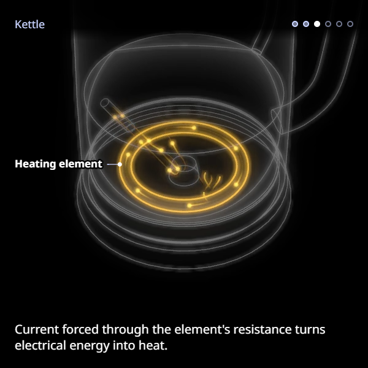 | 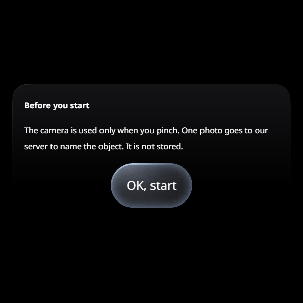 |

## Accessibility

| Area | What exists | Evidence | Gap |
|---|---|---|---|
| **Show, don't only tell** | The drawing carries the explanation; captions are short | [DESIGN.md "One rule"](../Meta_Challenge/app/shared/DESIGN.md#who-and-what-feeling) | Not tested with users with dyslexia or low literacy |
| **Audio alternative** | "Listen" reads the current step with browser speech synthesis in the display language, at a slightly slow rate (0.92); stops when the page is hidden; a voice error is shown rather than silent | [`ExploreView.tsx`](../Meta_Challenge/app/glasses/src/ExploreView.tsx) (`listen`); Android has "Read explanation" | Voice is the browser's default voice; audio routing on the glasses needs a listening test ([Design_Handoff](../Meta_Challenge/Design_Handoff.md#what-the-loaner-established)) |
| **Visual alternative for audio** | Every spoken line is also on screen; device states are cards, not sounds | [state cards](../Meta_Challenge/app/glasses/docs/states) | No haptic or other non-visual cue |
| **Languages** | English plus Finnish, Swedish, German, Spanish, French: explanation text, lens names, drawing labels, knob labels; the model answers in the chosen language; phone language picker | [i18n README](../Meta_Challenge/app/shared/i18n/README.md), [`lang.test.js`](../Meta_Challenge/app/bridge/test/lang.test.js), screenshot below | Machine-translated, not reviewed by native speakers; `i18n/check.mjs` currently reports gaps (newer objects fall back to English); button labels like "Pause" stay English |
| **Motion** | Film can be paused; any input holds auto-play for 20 s; WebGL spin only runs while something moves | [3D screen](../Meta_Challenge/app/glasses/docs/3d-screen.md) | **No `prefers-reduced-motion` handling** in the code yet |
| **Focus and structure** | Consent is a modal dialog (`role="dialog"`, `aria-modal`, labelled title), focus lands on its button; Web App built on Meta's Wearables UI toolkit components | [`App.tsx` ConsentScreen](../Meta_Challenge/app/glasses/src/App.tsx) | No screen-reader test; the Display's own accessibility settings were not checked |
| **Pace** | No time limit on a step; the user decides when to go deeper; "Watch again" and "Replay the beat" | 3D screen states | Auto-play exists in the film; users can pause |
| **One-handed, hands-free** | Navigation is on the wrist band; photo on pinch | [USE_CASE](USE_CASE.md#why-first-person-and-wearable-not-a-phone) | Needs the Neural Band; no alternative input on the glasses for users who cannot pinch (the phone remote buttons in the Android app act as one) |

| Finnish (machine-translated labels, English buttons) | Phone: language picker, ask field and glasses remote |
|---|---|
| 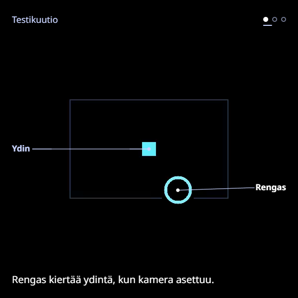 | 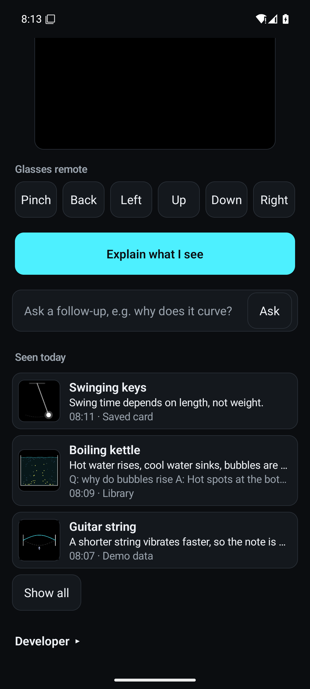 |

## Consent and data

| Point | What is true | Evidence |
|---|---|---|
| Camera only on request | Starts on pinch, button or "Again", takes **one** photo, releases the camera; it never streams in the background | [Android README](../Meta_Challenge/app/android/README.md), [Submission "Privacy and consent"](../Meta_Challenge/Submission.md#privacy-and-consent-what-is-true) |
| First-run consent | Glasses Web App card: "Each pinch sends one photo through our bridge to Google Gemini to recognise the object. We do not store it. Please do not point at people or bystanders without their permission." (stored in `localStorage` as `lens.consent`). Browser emulator: a **start screen** (WonderWhy name, what it does, the same privacy notice naming Google Gemini); the camera does not open and no photo can be uploaded until the visitor presses Start, and the choice is remembered for that browser session only ([`emulator.html`](../Meta_Challenge/app/bridge/public/emulator.html), bridge test `emulator.test.js`). Android card on glasses and phone: "Each pinch sends one photo to a model. Through our bridge. Not saved on the phone." with Agree / Not now (older, shorter wording that does not name Gemini). The trigger gate refuses a photo until consent is given | [`App.tsx`](../Meta_Challenge/app/glasses/src/App.tsx), [`TriggerGate.kt`](../Meta_Challenge/app/android/app/src/main/java/com/junction2026/lens/TriggerGate.kt), states `23-consent`, `24-consent-device-frame`, Android `80`..`82` |
| Photo storage | Android: held in memory for the phone preview, never written to disk. Bridge: the image is held in memory for the request and sent to the provider; only the developer-only `pi` / `claude` stand-ins write a temp file, which is deleted afterwards. The latency log keeps timings, object ids and request ids, not images | [`detect.js`](../Meta_Challenge/app/bridge/detect.js), [`server.js`](../Meta_Challenge/app/bridge/server.js) `queueLatency`, [`security.test.js`](../Meta_Challenge/app/bridge/test/security.test.js) |
| What leaves the phone | The photo (and centre crop) goes to our bridge and on to the model provider (Gemini on the live bridge); follow-up question text (max 300 characters) goes the same way; the microphone listens only while a result is on screen | [PROTOCOL](../Meta_Challenge/app/shared/PROTOCOL.md), [Submission](../Meta_Challenge/Submission.md#privacy-and-consent-what-is-true) |
| Provider retention | The model provider's own retention of the image is governed by Google's Gemini API terms, not by us. We have not audited it | see [bystander privacy and consent](#bystander-privacy-and-consent) and [README limitations](../README.md#known-limitations) |
| What stays on the phone | "Seen today": object, one-line summary, time, flag; kept in app preferences as JSON **without pictures**, at most 30 entries, can be cleared (Developer → Clear Seen today) | [`Journal.kt`](../Meta_Challenge/app/android/app/src/main/java/com/junction2026/lens/Journal.kt), Android `123_seen_today_three` |
| Auth | `LENS_TOKEN` protects `/detect`, `/ask`, `/rendered`, `/last`, `/latency` and WebSocket registration; token travels in the URL **fragment** (`#k=`), is stored locally and stripped from the address bar; never in git, QR images or logs; token sent only to the bridge's own host | [PROTOCOL "Auth"](../Meta_Challenge/app/shared/PROTOCOL.md), [`security.test.js`](../Meta_Challenge/app/bridge/test/security.test.js), states `19-token`, `20-token-fragment`, `21-token-foreign` |
| Judging mode | The live bridge is **open on purpose** so judges can try the emulator without a key. The cost is Gemini credit, bounded by a per-IP rate limit (**live: 10 requests per minute and 100 per hour per IP**, read from the server's `LENS_RATE_PER_MIN` and `LENS_RATE_PER_HOUR` on 15 Nov; the code default is 6 and 60) and 4 concurrent model calls; the bridge will be re-locked after judging. Nothing else changes about what is stored | [deploy README](../Meta_Challenge/app/deploy/README.md) |
| Secrets in the repo | `.env` files are git-ignored ([`.gitignore`](../.gitignore)); only [`bridge/.env.example`](../Meta_Challenge/app/bridge/.env.example) is tracked | |
| Abuse limits | 2 MB body, 64 KB WebSocket frame, 50 sockets, 4 concurrent model calls, a per-IP rate limit on `/detect` and `/ask` (429 `rate_limited` with a friendly message and `Retry-After`; the emulator shows that message), hostile JSON ignored, prototype-name object ids rejected, security headers set | [bridge README "Security notes"](../Meta_Challenge/app/bridge/README.md#security-notes) |

## Bystander privacy and consent

A photo taken in public can contain people who did not agree to it. WonderWhy is built to be pointed at an object, but the camera cannot tell. This is what we do and do not do.

| Question | Answer |
|---|---|
| Where does the photo go? | One JPEG per pinch (plus a centre crop of it) goes to our bridge, and from there to **Google Gemini** to name the object. Nothing else receives it |
| Do we keep it? | **No.** The Android app holds it in memory only; the bridge handles it in memory for the one request and writes no image to disk on the Gemini path (only developer-only stand-in providers use a temp file, deleted after the call). The latency log keeps timings and object ids, not images ([Consent and data](#consent-and-data)) |
| What does Google keep? | That is set by **Google's Gemini API terms** (including any retention for abuse monitoring) and the API plan in use. We have not audited it and make no claim beyond those terms. Treat the photo as shared with Google |
| How is consent asked? | A first-run **consent card** before the first photo: "Each pinch sends one photo through our bridge to Google Gemini to recognise the object. We do not store it. Please do not point at people or bystanders without their permission." In the Android app the trigger gate refuses a photo until the user agrees (its card is older and shorter and does not name Gemini). The browser emulator shows a start screen with the same privacy notice before it opens the camera, and uploads are blocked until the visitor starts it |
| What about the people in the frame? | They are not asked. We ask the **wearer** to avoid pointing the camera at people, and to hold the object close and fill the frame, which also helps recognition. The prompt asks only for a classification into a closed set of objects (JSON with an id, confidence and short answer), not for anyone to be identified or described ([`detect.js`](../Meta_Challenge/app/bridge/detect.js)); we run no face recognition and keep no profile of anyone |
| Is the camera always on? | No. It starts on a pinch or button press, takes one photo and releases the camera; it never streams |
| Abuse and cost | The live bridge is open for judging, so it has a per-IP rate limit on recognition and follow-up calls (10 per minute, 100 per hour per IP) and 4 concurrent model calls; it will be re-locked after judging |

Not built yet: automatic detection of people in the frame (the "Refuses to explain people" item is **planned**, see [Submission](../Meta_Challenge/Submission.md)), a visible capture indicator beyond the glasses' own hardware light, and venue signage text. For a venue pilot we would add signage and a supervised handover ([USE_CASE](USE_CASE.md#adoption-and-pilot-path)).

## Trust in the answer

| Mechanism | Behaviour | Evidence |
|---|---|---|
| Low confidence | Under 0.6 the app shows **"Not sure"** with the best guess, and opens no scene | [`v1-additions.test.js`](../Meta_Challenge/app/bridge/test/v1-additions.test.js), state `06-not-sure` |
| Outside the library | "Not in the library yet" and the model's one-sentence answer, then (live bridge, `SKETCH_PROVIDER=auto`) a generated 3D explanation about a minute later (57 s measured) while the glasses show "Drawing a sketch…": marked *unverified*, with its numbers flagged as estimates. If generation fails, the text answer stays | [bridge README "Sketches"](../Meta_Challenge/app/bridge/README.md#sketches), state `07-unknown`, Android `69_sketch_overview_unverified` |
| Where an answer came from | Phone receipt line: "Library card", "Sketch · unverified", "Saved card · offline", "Demo data", "Stand-in model" | [Android README](../Meta_Challenge/app/android/README.md), `125_receipt_library` |
| Physics checked | Library captions: team check plus an independent physics fact-check (18 captions corrected, curves recomputed) | [Submission "Known limits"](../Meta_Challenge/Submission.md#known-limits) |

## Error and device states

Every card has a short title, a plain sentence and one action ("Plain words, no exclamation marks, no Oops").

| State | Glasses (Web App) | Phone (Android) |
|---|---|---|
| Looking | [04-looking](../Meta_Challenge/app/glasses/docs/states/04-looking.png) | [114_looking_fi](../Meta_Challenge/app/android/docs/screens/114_looking_fi.png) |
| Took too long | 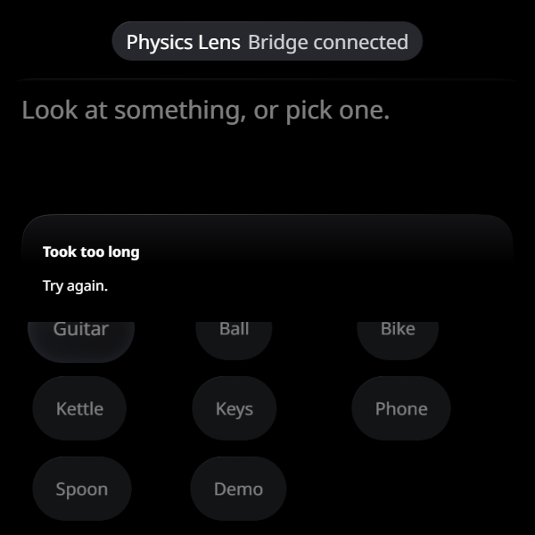 | [64_ask_error_timeout](../Meta_Challenge/app/android/docs/screens/64_ask_error_timeout.png) |
| Not sure | 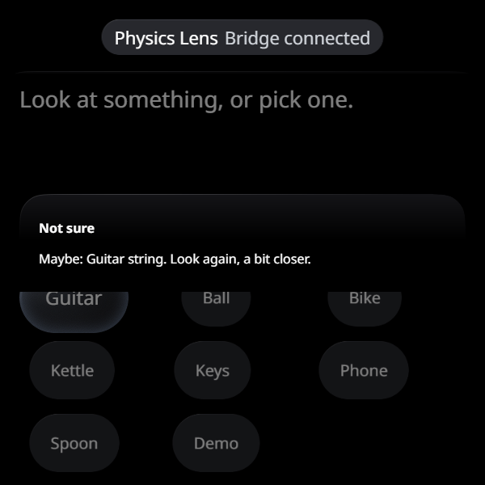 | [104_not_sure](../Meta_Challenge/app/android/docs/screens/104_not_sure.png) |
| Not in the library | 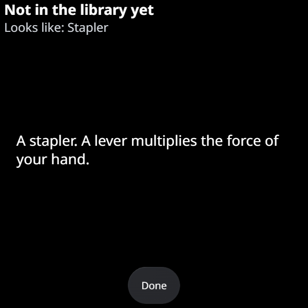 | [69_sketch_overview_unverified](../Meta_Challenge/app/android/docs/screens/69_sketch_overview_unverified.png) |
| Error | [08-error](../Meta_Challenge/app/glasses/docs/states/08-error.png) | 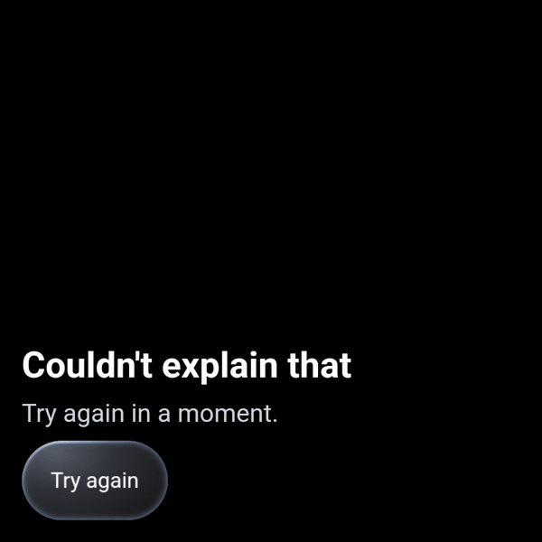 |
| Bridge locked | 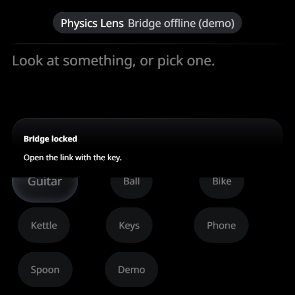 | [23_token_missing_401](../Meta_Challenge/app/android/docs/screens/23_token_missing_401.png) |
| Offline | [02-home-offline](../Meta_Challenge/app/glasses/docs/states/02-home-offline.png), [12-device-offline](../Meta_Challenge/app/glasses/docs/states/12-device-offline.png) | [106_offline_picker](../Meta_Challenge/app/android/docs/screens/106_offline_picker.png) |
| Bridge drops while looking | [09](../Meta_Challenge/app/glasses/docs/states/09-bridge-drop-while-looking.png) | [38_state_bluetooth_drop](../Meta_Challenge/app/android/docs/screens/38_state_bluetooth_drop.png) |
| Battery low | 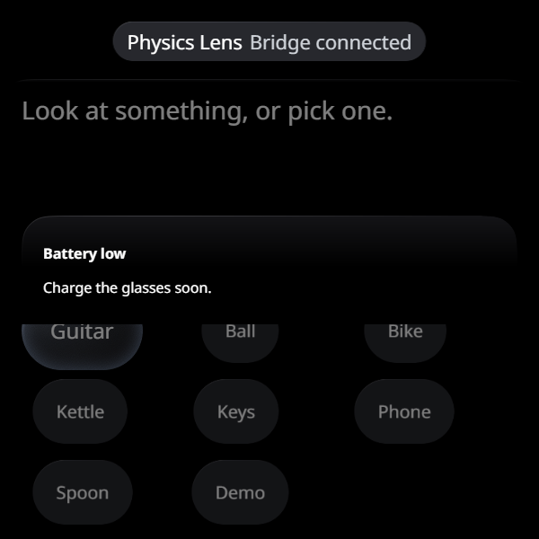 | [110_battery_notice](../Meta_Challenge/app/android/docs/screens/110_battery_notice.png) |
| Too hot | [11-device-thermal-hot](../Meta_Challenge/app/glasses/docs/states/11-device-thermal-hot.png) | [36_state_hot](../Meta_Challenge/app/android/docs/screens/36_state_hot.png) |
| Camera denied | 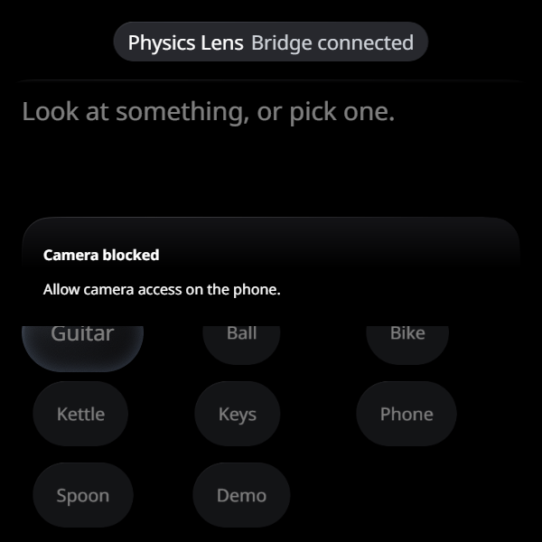 | 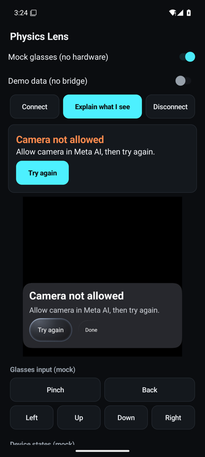 |
| Glasses taken off / on | [14-device-doffed](../Meta_Challenge/app/glasses/docs/states/14-device-doffed.png), [15-device-donned](../Meta_Challenge/app/glasses/docs/states/15-device-donned.png) | [30_state_taken_off](../Meta_Challenge/app/android/docs/screens/30_state_taken_off.png), [31_state_put_on_restored](../Meta_Challenge/app/android/docs/screens/31_state_put_on_restored.png) |
| Consent | [23-consent](../Meta_Challenge/app/glasses/docs/states/23-consent.png) | 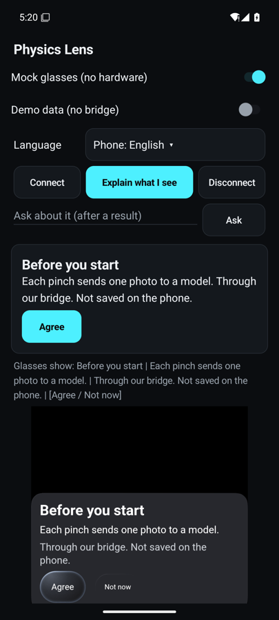 |

All 182 state and scene screenshots are listed with pass/fail in [`glasses/docs/README.md`](../Meta_Challenge/app/glasses/docs/README.md); the Android walk-through is in [`android/README.md`](../Meta_Challenge/app/android/README.md).

## Not yet done

- No usability study, and none with people who use assistive technology.
- No `prefers-reduced-motion` support; no non-visual feedback besides "Listen".
- Real-glasses audio routing, native clip playback and long-session behaviour unverified.
- Translations need native-speaker review and the i18n files need to catch up with the library.
